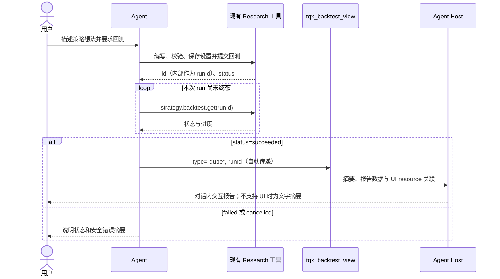
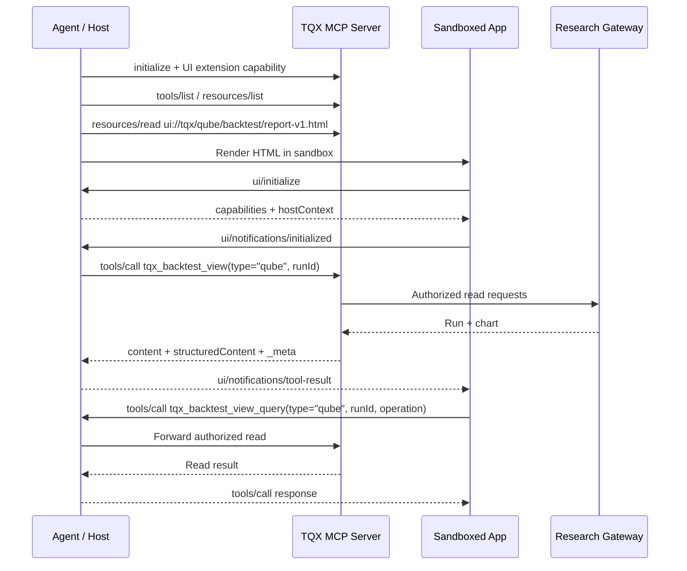

# TQX Backtest Canvas：MCP Apps 整体设计

状态：首期代码已实施，包含只读 MCP Apps 接入、真实数据投影、生产报告视图和本地调试工作台。核对日期：2026-11-25。真实授权 run、ChatGPT / Claude 宿主及视觉发布验收仍待完成；本地模拟器通过不能替代这些验收，见 6.6。

本文定义产品、视觉、交互、协议、调试和实施边界。原静态预览保留为视觉评审稿；生产报告的入口现为 `src/ui/qube/backtest/main.ts`，不从该原型取数，也不以样例作为接口失败后的回退。

当前可用的本地调试命令：

```bash
bun run --cwd packages/mcp-server dev:backtest-app
```

打开 `http://127.0.0.1:53043/`。外层工作台使用固定合成场景，通过标准 JSON-RPC 消息驱动 sandbox 中的同一份生产 HTML。工作台提供 `Production sandbox` 与 `Vue HMR` 两种模式：前者加载构建后的单 HTML 并在修改后重新加载，后者直接加载同一份 Vue 源码，样式和模板通过 Vite HMR 更新。无需 UAT、账号或提交新回测。

实施选择：使用 Vue 3 管理组件和局部状态、原生 SVG 绘图、官方 `@modelcontextprotocol/ext-apps` App / PostMessageTransport 与 Valibot 业务校验；Vite 8 配合 `vite-plugin-singlefile` 输出单 HTML。不引入 ECharts、全局 store 或 SDK v1；业务代码不直接使用 Zod，第三方 SDK 内部及其 peer dependency 使用 Zod 是允许的。`apps/qube/backtest` 只负责协议装配，`research/backtest-report` 负责数据，`ui/qube/backtest` 负责界面。生产打包会检查依赖图及 1 MiB 大小上限；Docker 构建和本包 start / dev 也准备静态产物。

## 1. 核心决策

主流程是：**用户描述策略想法，agent 编写策略、运行回测，并在回测成功后主动调用 `tqx_backtest_view`，由支持 MCP Apps 的宿主在同一对话中展示可交互报告。** `runId` 由 agent 从提交结果取得并在工具间传递；用户无需知道这个标识，也无需额外说“展示报告”。用户指定已有回测的场景作为第二入口保留。

TQX 是产品品牌，Qube 是其中一个子产品。展示工具通过必填字符串参数 **`type`** 标识产品来源，当前唯一合法值为 **`"qube"`**；agent 根据 Qube 工作流传入，不要求用户理解或填写。首期使用 Qube 专属 UI resource：`ui://tqx/qube/backtest/report-v1.html`。

报告以曲线为视觉中心，包含核心指标、交易记录、标的表现和冻结参数；左下角始终保留 **TQX 字标 + `Painted by TQX`**。`tqx_backtest_view` 是只读展示工具，策略编写与回测提交继续使用现有 Research 能力。

采用一个可缓存的 HTML UI resource，配合每次工具调用返回的结果数据；不为每个 run 生成 HTML，不把现有网站整页嵌入对话，也不让 iframe 直接访问业务网关。

| 项目         | 决策                                                                          |
| ------------ | ----------------------------------------------------------------------------- |
| 设计名称     | TQX Backtest Canvas，界面内标题以策略名称为主                                 |
| 产品类型     | `type` 必填，字符串仅接受 `"qube"`；当前不支持其他产品值                      |
| 工具间标识   | `runId`，由 agent 内部传递；只接受当前 Research 契约中的 24 位小写十六进制 ID |
| 默认触发     | 用户要求运行的回测达到 `status=succeeded` 后，agent 主动调用展示工具          |
| agent 入口   | `tqx_backtest_view({ type: "qube", runId })`                                  |
| UI resource  | `ui://tqx/qube/backtest/report-v1.html`                                       |
| MIME         | `text/html;profile=mcp-app`                                                   |
| UI 查询入口  | `tqx_backtest_view_query`，仅 app 可见，操作限定为本报告的只读查询            |
| 展示模式     | 默认 `inline`，响应宿主切换到 `fullscreen`；首期不做 `pip`                    |
| 权限         | 仅 `research:read`；已有登录、token exchange、数据归属校验继续生效            |
| 支持市场     | 首期 HK / US，与当前 MCP Research 校验保持一致                                |
| 非 Apps 宿主 | 同一入口返回有意义的文字和结构化摘要                                          |
| 本次交付     | 报告工具 / 资源、数据投影、生产视图、调试工作台及测试；未部署或连接真实宿主   |

## 2. 源码核对与可复用能力

### 2.1 为什么选 runId

已核对 Qube Next 的回测 API、前端结果类型、回测面板、曲线和指标格式化逻辑：

- 策略回测详情路径使用 `/api/strategy-backtests/{run_id}`；曲线和结果在该 run 下读取。
- 回测详情主标识是 `id`；部分响应带 `run_id`，前端已有 `run_id || id` 的归一化逻辑。图表响应明确带 `run_id`。
- 当前 MCP Research 的 `strategy.backtest.get`、`backtest.chart.get`、`backtest.result.get` 输入已经统一为 `runId`；提交回测得到的 `id` 就是后续传入的 `runId`。
- `strategyId` 指策略资产，不能定位一次确定的执行；`requestId`、对话 run、调优任务 ID、版本 ID 也不能替代回测 `runId`。

因此不新增 `backtest_id` / `backtestRunId` / `bactest` 别名。`runId` 是工具输入契约，不是用户使用报告的前置知识。用户说“回测 ID”时，agent 应将已知的回测执行 ID 映射为 `runId`，不猜测最近一次执行。

### 2.2 现有 MCP 数据契约

以下能力已经实现，报告层应复用同一 action / gateway / 校验逻辑，而不是从 UI 拼 HTTP 路径：

| 当前 action             | 已有能力                                                                            | 报告用途                     |
| ----------------------- | ----------------------------------------------------------------------------------- | ---------------------------- |
| `strategy.backtest.get` | 状态、指标、冻结参数、source/config revision、策略归属                              | 报告身份、KPI、参数          |
| `backtest.chart.get`    | `from` / `to`、`maxPoints`，曲线、基准、交易日、日期锚点、完整性信息                | 初始全区间曲线、缩放重取     |
| `backtest.result.get`   | `equity` / `trades` / `logs` / `symbol_performance` / `account_summary`，分页、搜索 | 交易、标的、账户摘要按需读取 |

曲线的当前 `maxPoints` 范围为 2..5000，默认 1000。结果页 limit 上限为 500。引擎指标与结果行保留原字段名；报告只在展示层归一化。

仓库内可复核入口：

- [Research action 实现](../src/research/tools/actions.ts)
- [输入和输出 schema](../src/research/schemas.ts)
- [响应映射](../src/research/projections.ts)
- [Gateway 和响应预算](../src/research/gateway.ts)
- [现有工具注册](../src/research/tools/research.ts)
- [资源目录与分页](../src/research/resources/list.ts)
- [现有 Research 方案](research-tools-plan.md)

本文只记录从相邻项目核对得出的公共接口和展示结论，不复制其源码、内部仓储结构或运行配置。

### 2.3 必须处理的实际差距

1. **报告元信息不齐。** 当前 run 的内部映射虽有 title / market，但 `runOutput('backtest')` 的 state schema 不保留这两个字段；不能假设调用现有 action 后一定能取到。新增报告专用投影/schema，保留上游已提供且经过校验的冻结 title / market，不改变已有 action 的输出合同。不用当前策略名称、参数或 revision 冒充历史快照。上游未提供时显示中性标题和未知市场，币种不猜测。
2. **部分运行信息尚未暴露。** 当前输出没有完整保留 `performance_preview`、`finished_at` 等信息。预览指标、准确耗时等不作为已有能力承诺；需要时在报告专用合同中有依据地补齐。
3. **资源目录被接管。** 现有 `resources/list` 由自定义分页 handler 统一处理，会绕过 SDK 静态资源列表。只 register UI resource 并不能让它出现在目录里，必须合入现有目录。
4. **市场范围有差异。** Qube 页面还支持其他市场，当前 MCP Research 校验只支持 HK / US，首期不扩张市场 schema。
5. **K 线没有 MCP 能力。** 网页的标的 K 线不在现有 Research action 中。首期标的抽屉展示交易和标的表现，不承诺行情蜡烛图。
6. **图表不是任意小的载荷。** `maxPoints` 只限制曲线点，不限制所有交易日、日期锚点和交易预览。当前 gateway 默认单响应上限 4 MiB，需要单独制定 UI 投影和超限处理。

### 2.4 当前工具逐字段核对（2026-11-25）

**不能承诺 HTML 所有内容都已由当前工具直接提供。当前 HTML 是合成数据原型，没有连接接口。** 已读取已部署的 `tqx_research_explore` 四个 action 的 schema，并与本仓库 schema / projection、上游公开响应处理及网页字段适配规则交叉核对。随后只读调用 `strategy.backtest.search({market:"hk",status:"succeeded",limit:1})` 和不限定市场的成功回测搜索，均返回 `items:[]`、`hasMore:false`。因此没有可用于本次实读核验的成功 run，未验证真实 run 的明细响应，也未提交新回测。下表表示契约与源码支持程度，不冒充逐字段真实结果验收。

表中 `get`、`chart`、`result` 分别代表 `strategy.backtest.get`、`backtest.chart.get`、`backtest.result.get` 的直接 `structuredContent`，没有额外 `data` 包裹。

| 展示内容                               | 当前来源                                                                                                 | 限制与缺失行为                                                                                                                                   |
| -------------------------------------- | -------------------------------------------------------------------------------------------------------- | ------------------------------------------------------------------------------------------------------------------------------------------------ |
| run 身份、状态                         | `get.id`、`resourceId`、`status`、`terminal`                                                             | 使用 `runId` 请求；`terminal` 不等于成功，失败不能显示 Completed                                                                                 |
| 策略标题、市场                         | get 的当前输出 **不包含** `title` / `market`；search 摘要可选提供                                        | 报告专用投影直接读取并校验同一 run 的原始详情中的冻结 title / market；现有 action 输出不变。不能拿当前策略补齐。缺失用 Backtest report、未知市场 |
| 币种 HKD / USD                         | chart 无 currency；get 无 market                                                                         | 仅在同一 run 的已验证市场和回测账户币种语义成立时按 HK / US 映射。缺失不显示 HK$ / $，不从 symbol 猜币种                                         |
| 配置起止日期                           | `get.parameters.backtest.period_start` / `period_end`                                                    | 嵌套字段可选，保留服务端 snake_case。图区实际范围来自 `chart.range` / `extent`，不能把创建时间当回测区间                                         |
| 初始资金、频率                         | `get.parameters.backtest.init_balance` / `frequency`                                                     | 可选；频率只按明确枚举映射，`1d` 为 Daily，`1M` 为 Minute，不能当 Monthly                                                                        |
| 总收益、年化、回撤、夏普、索提诺、卡玛 | `get.metrics` 中第 5.1 节明确列出的键                                                                    | metrics 是可空开放对象，内层各指标不保证存在。上游可能提供，不代表 schema 保证；缺失显示 `—`，不从采样曲线补造                                   |
| 最终权益、成交笔数                     | `get.metrics.final_equity` / `trade_count`，仅允许明确别名                                               | 非终态显示 Current equity。完整未过滤 trades 的 `result.total` 可单独标为记录数，不默认为同口径引擎指标；partial 时不称最终                      |
| 曲线及 hover 日期 / 金额               | `chart.points[].ts` / `equity`                                                                           | 吸附到返回样本。保留 null、`breakBefore`、`sampled`、`partial`、`complete`；不能承诺任意时刻精确值                                               |
| hover / 纵轴收益率                     | `equity / get.parameters.backtest.init_balance - 1`                                                      | 这是明确的展示层计算，不是 chart 原生 return 字段；仅在冻结初始资金为有效正数时可用，否则禁用收益率视图。不用首个采样点当基线                    |
| 日期轴、买卖标记                       | `chart.dateAnchors`、`tradeDays`，以及返回的 trade 字段                                                  | 不生成交易日或虚构交易标记。原型的日历日期只是合成序列，不是港股交易日历                                                                         |
| 交易日期                               | `result({field:"trades"}).rows[]` 的 `display_ts / ts / timestamp / datetime / trade_date / time / date` | 开放行结构，按列验证已知字段；缺失显示 `—`，未确认时区时不擅自转换                                                                               |
| 交易标的、方向                         | 行的 `symbol / code / instrument / symbol_code`；`direction / side / action / offset`                    | 仅明确枚举规范化买卖，不靠数量正负猜方向                                                                                                         |
| 交易数量、成交价                       | 行的 `quantity / qty / volume`；`price / fill_price`                                                     | 校验数值后显示；不补手续费、盈亏等未返回字段。分页与过滤沿用返回的 total / hasMore / nextOffset                                                  |
| TQX 字标、Painted by TQX               | 静态品牌资源                                                                                             | 不是业务数据，不需要接口返回                                                                                                                     |

已删除原型中的“行业轮动，每 5 个交易日调仓”和“等权 · 总仓位 90%”：当前通用回测合同没有这些字段，不能推测。改为已有冻结参数支持的 Start date / End date；标题改为中性 Backtest report。HK 及其币种仍仅属于明确标记的合成场景，不代表当前 get 已提供这些字段。

目前所有数值（含 −5.06%、风险比率、14 笔、三行交易和曲线）都是视觉 fixture，不是上述搜索返回的结果，也不能据其作投资结论；风险指标未由该曲线重新计算。正式 UI 只能显示成功读取且校验通过的数据，错误或缺失时不得回退到 fixture。

## 3. 视觉方向

### 3.1 可直接打开的静态 HTML

本轮默认英文，后续再考虑多语言；本轮视觉入口为 [深色液态玻璃预览](backtest-mcp-app-preview.html)。单文件包含内联 CSS、SVG 曲线、少量交互脚本、官方 TQX 字标和内嵌的官网 Inter / ABC Whyte Inktrap 字体，双击即可在普通浏览器打开，不需账号、后端、构建、网络字体或 UAT。当前预览也可用下列命令启动：

```sh
python3 -m http.server 8080 --bind 127.0.0.1 --directory packages/mcp-server/docs
```

从仓库根目录运行后，打开 `http://127.0.0.1:8080/backtest-mcp-app-preview.html`。修改 HTML 后刷新浏览器即可；这一版没有热更新服务。

预览仍是无后端的单文件静态页面，增加少量内联 JavaScript 实现曲线探查：鼠标在绘图区任意位置移动时，按横轴日期吸附到最近的样本，同时显示十字线、定位点、日期、账户权益和累计收益率；浮层不重复市场名和图例标题，只保留日期、主数值与另一项数值。切换纵轴后浮层的主数字跟随切换。左右边缘自动避让并把浮层限制在绘图区内，响应式缩放使用 SVG 坐标转换。鼠标移出关闭，鼠标点击不显示默认 focus 蓝框或原生 SVG title 提示；键盘导航时仅显示细中性灰焦点提示。也可点按查看，用左右方向键逐日查看、Home/End 到首尾、Escape 关闭，键盘操作提供文字播报。日期与金额来自内置的同一组按日示意数据，不从线段插值推导收益。

四个 KPI 的 info 图标使用自定义深色玻璃提示，悬停或键盘聚焦即时显示，点击可固定，再次点击、点击外部或 Escape 关闭；提示可被悬停并限制在卡片边界内。

当前视觉基线固定为以下结构：

- `BACKTEST REPORT` 与黄色小方点位于玻璃卡片外的左上方，距卡片 20px。
- 玻璃卡片内部从标题开始，右侧为状态和回测日期；标题下不增加市场、数据来源或说明行。
- 官方 TQX 字标与 `Painted by TQX` 位于玻璃卡片外左下方，距卡片 24px，窄屏为 20px；与上方角标的黄色小方点沿同一左边线对齐。
- 页面不显示 Canvas study 标签、右下角 BACKTEST 标记、底部预览声明或操作指南；必要的数据完整性信息集中在图表区。

数据仍为合成 fixture；当前页面保留 Completed · Demo 与交易明细中的示意标记，来源及限制由本文记录。正式报告只显示真实状态，不携带这些 Demo 文案。

权益/收益率纵轴切换仍由原生 radio + CSS 完成，交易明细用原生 details 展开。概览条仅表示布局，不支持拖动；没有真实查询、宿主握手或屏幕阅读器数据表。曲线、指标和三笔交易展示均为示意；不把它们当作正式数据或完整可访问性验收结果。此前浅色方向已按最新反馈废弃，当前深色 HTML 为视觉评审依据。

#### 原静态预览与生产实现的边界

| 能力                                        | 当前静态 HTML                         | 当前生产代码                                             |
| ------------------------------------------- | ------------------------------------- | -------------------------------------------------------- |
| 深色液态玻璃、英文、卡片外角标与署名        | 已实现                                | 复用当前视觉基线                                         |
| 权益/收益率切换、最近样本定位、三行 tooltip | 已实现，使用合成数据                  | 使用校验后的 chart 与冻结初始资金                        |
| 四个 KPI info 提示                          | 已实现，支持悬停、聚焦、点击及 Escape | 沿用交互，释义与实际引擎口径一致                         |
| Performance / Run settings、交易展开        | 已实现，交易仅三行示意                | 真实字段、缺失值与按需分页                               |
| 概览条与买卖标记                            | 仅静态绘制                            | 范围查询、日期替代控件与交易入口                         |
| 基准、标的表现、完整参数、数据表            | 原型未实现                            | 已实现按需读取与分页，缺失不补造                         |
| 宿主 bridge、fullscreen、受限高度布局       | 原型未实现                            | 标准 bridge 与模拟器已实现；真实宿主待验收               |
| fixture 工作台、宿主模拟器、回放            | 原型未实现                            | 已实现 Vue HMR、生产沙箱与脱敏 overview 文件回放，见 8.3 |

### 3.2 视觉原则

**深色液态玻璃，保留呼吸感、通透与轻盈。** 依据用户指定的 TQX Web `AGENTS.md` 设计规范及已有设计 token：使用 `#030303` 基底、白色文本层级、克制的 `#ffff3a` 强调色。曲线保持中性白，负值使用 `#ff4d4d`，买入/成功语义使用 `#34d399`，不把亏损曲线涂成盈利绿。

主报告使用规范中的 156° 透明渐变、12% 白边、24px 圆角、顶部内高光与阴影；32px 背景模糊来自既有玻璃 token。独立预览背景上的低透明中性弧形高光为玻璃提供可见的透射层次，不移动、不遮挡文字；正式资源保留同样克制的透射背景，不包含原型的预览说明或调试外壳。浮层和分段控件使用同一材质，不额外堆叠装饰卡片。不支持背景模糊时回退为深色实底。

实现位于本 MCP package，不修改 TQX Web 应用。Nuxt 组件、导航、i18n CLI 和字体子集生成属于该应用的交付流程；本原型不引入这些运行时。根据最新要求，HTML 的可见文案、tooltip、ARIA 说明及键盘播报统一英文，多语言留待后续设计。

当前 TQX 视觉基线在浅色宿主中仍固定深色 token；遵守容器尺寸、安全边距和缩放能力。ChatGPT 的原生视觉指南与此存在差异，按 6.6 单独记录发布决策，不把协议支持等同于视觉审核通过。正式接入时按 MCP Apps 的宿主上下文协商能力，不改变协议消息。

### 3.3 布局与信息层级

```text
  ▪ BACKTEST REPORT

┌──────────────────────────────────────────────────────────────────────────────────┐
│ Backtest report                                                 Completed · Demo │
│                                                          2026.09.28 — 2026.10.26 │
│                                                                                  │
│ Total return i      Annualized return i Max drawdown i      Sharpe ratio i       │
│ −5.06%              −49.52%             −7.30%              −1.62                │
│                                                                                  │
│ Equity curve                                 Strategy equity   [Equity / Return] │
│                                                                                  │
│ Equity curve + crosshair + date / primary value / secondary value                │
│                                                                                  │
│ Date axis + full-period overview                                                 │
│ FULL PERIOD                                        Metrics cover the full period │
│ ──────────────────────────────────────────────────────────────────────────────── │
│ Performance                                                         Run settings │
│ Final equity, Trades, risk ratios       Dates, initial capital, frequency        │
│ ──────────────────────────────────────────────────────────────────────────────── │
│ Trade details                                                  3 demo rows   [⌄] │
└──────────────────────────────────────────────────────────────────────────────────┘

  TQX  |  Painted by TQX
```

上图描述当前静态预览的信息顺序；宽屏四个 KPI 同排，窄屏为 2×2。正式版的全屏、基准、刷选与详情入口按第 4 节渐进添加，不默认增加顶部工具栏。

顶部不重复 agent host 的头像、聊天工具栏或网站导航。状态“已完成”只描述任务结束，不代表盈利。大标题使用冻结的策略名称；完整 `runId`、revision、参数放在详情中，提供选择复制的纯文本。

静态版采用资产表现与参数双列摘要、按需展开的交易明细；生产版 inline 保持单一视图，标的表现、完整参数和短页列表按需展开，fullscreen 增大每页条数，不在 inline 卡片内叠加深层导航或滚动区。

四个首屏指标固定顺序为总收益、年化收益、最大回撤、夏普。最终权益、交易笔数、索提诺和卡玛放在概览次级区域；基准指标仅在有相应数据时出现。不要把所有数字做成等权的大卡片。

### 3.4 设计 token

| 类别               | 深色方案 / 约束                                                                                             |
| ------------------ | ----------------------------------------------------------------------------------------------------------- |
| 基底               | `#030303`，背景覆盖完整视口                                                                                 |
| 主 / 次 / 辅助文本 | `#fff` / `rgba(255,255,255,.6)` / `rgba(255,255,255,.5)`                                                    |
| 玻璃表面           | 156° 渐变，白色 alpha `.02` / `.007` / `.004`，位置 8% / 46% / 92%                                          |
| 玻璃边界           | `1px solid rgba(255,255,255,.12)`；分隔线 alpha `.06`                                                       |
| 高光与阴影         | `inset 0 1px 0 rgba(255,255,255,.22)`、`inset 0 0 24px rgba(255,255,255,.03)`、`0 8px 32px rgba(0,0,0,.42)` |
| 强调 / 正向 / 负向 | `#ffff3a` / `#34d399` / `#ff4d4d`，保留正负号                                                               |
| 曲线               | 中性白 alpha `.88`，约 2px；不改变实际数据形状                                                              |
| 字体               | UI 为 Inter；展示数字为 ABC Whyte Inktrap Medium，回退 Inter / system-ui                                    |
| 标题 / 主数字      | `36px / 45.13px / 500`、`42px / 48.74px / 500`，窄屏离散缩放                                                |
| 间距               | 页面 40px，区段以 20 / 30 / 40px 为主；窄屏保留 18–22px 内容边距                                            |
| 圆角               | 玻璃面板 24px、tooltip 12px、分段控件全圆                                                                   |

静态预览内嵌现有官网字体，仅用于本地设计评审，无网络字体请求。正式公开资源打包前确认字体许可和可发布范围；许可未确认时使用规定的 Inter / system-ui 回退。TQX 字标保留内联官方矢量。

报告根节点固定 `color-scheme: dark`。tooltip、展开内容、错误态和无数据态都使用同一深色体系，不能混入默认白色背景。辅助低透明标签不可用于承载唯一的必要信息；正式实现仍需验证文字与背景合成后的对比度。

### 3.5 左下角品牌签名

这是交付的固定验收项，不是可删的装饰：

- 使用与官网页脚相同气质的 **TQX 文字字标**，而不是 QUBE 立方体或顶部导航的组合图标。
- 已核对官网页脚实际采用 ABC Whyte Inktrap 排版的 TQX 文本。静态预览已内联官网现有官方 SVG 字标，避免字体缺失时变成普通系统字；生产打包继续复用经确认的同一份矢量资源。
- 完整署名固定为 **`Painted by TQX`**，大小写不变，不随语言翻译，不替换为 Powered by。
- 宽版：字标约 64–80px 宽，署名 12px，位于玻璃卡片外的左下方，与卡片外上方角标对齐（相对卡片外边线内缩 4px）；窄版字标约 48–64px，署名可以换行，但不能省略。
- 深色画布使用白色字标；不透明、不作为曲线水印，不覆盖轴标签。
- footer 是 app 根布局的独立底行，与玻璃卡片为兄弟节点；无玻璃背景、边框或卡片内分隔线。inline 使用自然高度，署名跟随内容，不为固定署名引入内部纵向滚动；fullscreen 仅让 iframe 文档自身纵向滚动，角标、报告与署名一起自然排列，不在玻璃卡片或表格内再开滚动区，并避让宿主 composer 与 safe area。不得固定到宿主页面。
- 加载、无数据、权限错误、失败和全屏状态均保留署名。尊重宿主 safe area；不能被 tab、tooltip 或抽屉遮住。

### 3.6 响应式与可访问性

以下为正式版的响应式目标。当前静态 HTML 在宽度大于 720px 时四个 KPI 同排，720px 及以下为 2×2；详情区在 600px 及以下改为单列。按实际容器宽度布局，不按 agent host 品牌判断：

| 容器         | 布局                                                    |
| ------------ | ------------------------------------------------------- |
| >720px       | 四个 KPI 横排，主图建议高 260–320px，详情可双列         |
| 480–720px    | KPI 2×2 或主次混排，主图 220–260px，详情单列            |
| 320–479px    | KPI 2×2，主图约 200px，缩减日期刻度，tab 与控件自动换行 |
| 宿主高度很小 | inline 优先总收益和曲线，精简详情；全屏入口由宿主提供   |
| fullscreen   | 随宿主容器重排，单一文档滚动；不假设一定是浏览器全屏    |

默认 inline 可先以约 720–880px 评估内容高度；使用自然高度并报告 size-changed，宿主接受请求高度时不增加内部纵向滚动。若宿主限制 inline 高度，允许 iframe 文档自身作为唯一滚动区，不在卡片或列表中再套滚动区；不能保证宿主无限撑高。全屏仅保留 iframe 文档纵向滚动；玻璃卡片、图表和列表不设独立滚动区。680px 及以下，结果表格改为带字段名的记录卡片，不出现横向滚动条。生产 bridge 已实现宿主尺寸协商。这些数值仅作为请求尺寸的设计目标，服从 `containerDimensions`。遵守宿主给出的 width / maxWidth / height / maxHeight 与安全边距；不把目标高度写成固定最小高度。

正式版键盘应能操作图例、日期输入、刷选器替代控件和 tooltip 定位。当前预览已支持模式切换、曲线定位、info 按钮和交易展开；尚无日期输入、交互图例或刷选控件。触摸操作使用点按固定 tooltip，保留页面纵向滚动；不把所有手势交给图表。正式版主要触摸控件目标约 44px；当前 info 按钮为 24×24px，仍需结合触摸体验验收。

正式版曲线应有文字摘要与可展开的数据表；当前预览只有键盘定位播报，尚无数据表。买卖标记分别用方向、形状和文案区分。正文对比度目标 4.5:1，关键图形与控件边界 3:1；绿色、红色和黄色都要单独检查。支持 `prefers-reduced-motion`，不播放逐点“盈利增长”动画。

## 4. 交互规格

### 4.1 从策略想法到报告的主流程

用户：“帮我写一个港股动量策略，回测一下表现。”

用户表达策略和回测意图后，agent 应完成从编写到展示的整个流程。只有缺少必要的策略设定时才向用户澄清；获取 `runId` 和展示本次结果不需要额外追问。

1. **编写与校验策略。** 使用现有 Research 流程创建或更新策略、保存源码并检查校验结果。普通回测先通过 `strategy.update` 保存用户设置，确认 `parameterValidation.status=valid`、revision 一致且没有 `parametersDraft`；遵守现有提交与授权契约。
2. **提交并保存身份。** 调用 `strategy.backtest.submit`，将响应的 `id` 保存为本次 `runId`，后续始终绑定这一执行。不能用 strategyId、调优任务 ID 或搜索到的其他 run 替代。
3. **等待本次运行成功。** 通过 `strategy.backtest.get({ runId })` 读取同一 run；沿用现有指引，约每 2 秒查询并在限流时退避。`queued`、`preparing`、`running` 均继续等待，只有 `status=succeeded` 才触发默认展示；`terminal=true` 不足以判定成功。幂等提交若直接返回 `succeeded`，可直接进入展示步骤。
4. **主动展示原生报告。** 成功后立即调用 `tqx_backtest_view({ type: "qube", runId })`。用户无需再次要求展示，也无需复制或提供 ID。宿主按协商能力渲染原生 MCP Apps UI；agent 配合简短解读，报告成为这次回测的默认结果交付。

这里的 `strategy.*` 名称是现有 Research action，由对应 MCP 工具调用；`tqx_backtest_view` 是本方案拟新增的独立 MCP 工具。



异常和批量场景的衔接规则：

| 情况                                 | agent 行为                                                                                                                                                       |
| ------------------------------------ | ---------------------------------------------------------------------------------------------------------------------------------------------------------------- |
| `failed` / `cancelled`               | 停止依赖成功结果的步骤，说明状态与错误；不作为成功报告自动展示，不擅自重新提交。用户仍可主动打开失败 run 查看诊断。                                              |
| 等待超时或读取暂不可用               | 保留本次 ID 和最后状态；`LIVE_RESULT_UNAVAILABLE` 退避重读同一 run，不重新提交、不自动取消。无法继续等待时说明尚未确认成功，后续继续查询同一 run，成功后再展示。 |
| `succeeded` 但图表或结果仍为 partial | 仍调用展示工具，展示已确认的成功状态与可用数据，保留分区完整性和错误提示，不为等待所有数据齐全而无限阻塞。                                                       |
| 展示工具读取失败                     | 保留本次成功结果和身份，按错误语义重读或给出摘要；不因展示失败重跑回测。                                                                                         |
| 宿主不支持 MCP Apps                  | 调用同一展示工具并使用其文字和结构化摘要，不要求用户查找 ID 或打开另一套流程。                                                                                   |
| 多轮调优或批量回测                   | 默认展示最终选定或用户明确要求的结果，不为每个中间 run 自动创建卡片。                                                                                            |
| 用户明确要求只要文字                 | 尊重其展示偏好，提供结果摘要。                                                                                                                                   |

默认自动衔接是产品和 agent 的工作流约定，由工具描述与任务指引引导；MCP 协议本身不保证模型必然调用下一个工具。策略写入、执行权限及宿主已有的工具调用审批继续生效，展示工具仍只需要 `research:read`。不新增“请提供 runId”或“是否展示”的产品步骤。

#### 4.1.1 打开已有回测

第二入口是用户要求重新打开某次已有回测，例如“把刚才那次回测展示出来”，或直接提供 `runId`。agent 从当前上下文确定对应执行，并调用 `tqx_backtest_view({ type: "qube", runId })`，无需 strategyId、URL 或前端配置。已有明确 ID 时不重新提交；上下文有多个候选且无法确定时才澄清目标，不猜测最近一次执行。报告本身仍支持非终态和失败状态，便于用户主动查看进度或诊断。

初始化显示与最终布局一致的骨架，品牌 footer 从第一帧出现。先展示可用的状态和指标，再局部补齐曲线；曲线错误不能把已有的 KPI 和身份信息清空。

### 4.2 曲线探索

| 操作              | 行为                                                              | 数据请求             |
| ----------------- | ----------------------------------------------------------------- | -------------------- |
| hover / 点按      | 吸附到最近返回样本，显示日期、主值、次值三行；点按可固定          | 使用已加载数据       |
| 切换权益 / 收益率 | 权益按币种；收益率相对于本次冻结初始资金，保持整次 run 的同一基线 | 本地展示转换         |
| 点击图例          | 显示/隐藏策略和已有基准；最后一条曲线关闭时显示明确空态           | 无                   |
| 显示交易标记      | 按交易日显示买/卖汇总；高密度时聚合，不伪装为逐笔精确位置         | 无                   |
| 拖动概览刷选器    | 保留全区间概览，在选区重取更高分辨率曲线                          | 防抖后 query/chart   |
| 输入起止日期      | 键盘可替代拖动，验证范围，显示市场时区                            | query/chart          |
| 重置范围          | 回到整次 run；恢复初始概览                                        | 优先已加载全区间数据 |
| 点交易标记        | 展开该交易日摘要；可进入交易 tab，用户明确筛选或翻页              | 必要时 query/result  |

曲线 tooltip 的默认内容固定为三行：日期、当前模式的主值、另一模式的次值。Equity 模式显示权益主值与 Total return 次值；Return 模式反过来。若冻结初始资金无效，禁用 Return 模式并省略收益率行。浮层不增加市场名、图例重复项、基准行、交易计数或操作指引；基准与成交信息通过其独立入口查看。鼠标移出关闭；键盘支持左右方向键、Home/End 和 Escape。指针操作不显示蓝色 focus 框，键盘操作保留细中性焦点提示，不使用原生 SVG title 弹层。

上述行为是正式版规格：当前静态 HTML 已实现最近样本定位、模式切换、三行内容与键盘导航；触摸点按可查看，但未实现独立的固定/取消固定控件。采样与 partial 状态放在图表说明区域，定位点始终对应真实返回样本，不按线段插值制造数值。

首屏建议 `maxPoints=600`，全屏或选区可提高到 1200；遵守现有 5000 上限。停止拖动约 250ms 后发请求，同一区域只保留一个有效请求。旧响应不能覆盖新窗口，切换 run 后旧响应直接丢弃。

当前 result 接口没有交易日期筛选参数，不能把点击一天后的第一页交易当作“当天全部交易”。交易标记中的记录只是预览；完整列表按已有分页、keyword、symbol 能力读取，展示范围写清楚。若后续需要精确按日分页，应先补充公共上游契约。

### 4.3 详情区

以下详情在 inline 按需展开，使用短页列表；fullscreen 增大每页条数。两种模式共用自然文档流，不放多层 tab、抽屉导航或独立滚动表格，不强行在 inline 塞入完整工作台。

- **概览：** 最终/当前权益、交易笔数、次级风险指标；账户摘要按需获取。索提诺、卡玛显示数值与简短释义，缺失值为 `—`。
- **标的表现：** 代码、名称、收益、交易笔数，采用分页和搜索。零记录显示空态，不能推导为“没有持仓”。不从该表虚构当前持仓或当前市值。
- **交易：** 按原有引擎行字段展示时间、标的、方向、数量、价格、手续费；缺失列不填零。使用明确的上一页/下一页，保留总数和 `hasMore` 信息。
- **参数：** 只读展示回测冻结的日期、频率、初始资金、手续费、滑点、基准和 revision。参数单位遵循对应市场的已有合同，不把裸值自行标成百分比。

参数中的 Strategy ID 使用品牌黄色、细下划线和外链箭头强调；地址由报告的真实 `strategyId` 生成：`https://www.tqx.ai/qube/strategies/{strategyId}`。点击通过官方 `App.openLink` 请求宿主打开，不在报告 iframe 内导航。仅在宿主声明 `openLinks` 且连接有效时呈现链接；否则保留可复制的 ID 文本。宿主拒绝或请求失败时显示简短错误，链接仍可复制。窄屏允许编号换行，不增加横向滚动。

日志不进入首屏，不在首期 app 提供；需要排障时 agent 仍可使用已有 Research action。首期也不提供重跑、取消、调参应用、下单或编辑策略按钮。

### 4.4 指标释义

四个首屏 KPI 的 info 按钮使用同一深色玻璃浮层：悬停或聚焦即时打开；鼠标可移入浮层阅读；点击固定，再次点击、点击外部、失焦或 Escape 关闭。浮层不超出玻璃卡片边界，窄屏自动避让。按钮使用英文可访问名称及 `aria-describedby`；指针不显示默认蓝框，键盘焦点清晰可见。

释义只解释指标口径，不添加接口未提供的数值或假设。年化收益保留短区间敏感性说明；夏普不凭空补充无风险利率；缺失指标保留 `—`。当前四个 KPI 已有释义，索提诺和卡玛的进一步帮助属于后续实现。

### 4.5 与对话协作

“Analyze backtest”是可选的次级按钮，用于让 agent 分析当前回测视图：

1. 用户点击后，组织一段有界的上下文：type、runId、所选日期、图例选择、采样/完整性状态、全周期指标及其口径。
2. 宿主允许时用 `ui/update-model-context` 更新当前 app 上下文；只发送用户选择的摘要，不发送整个交易表。
3. 用 `ui/message` 请求在对话中分析所选内容。采用官方 SDK 时，对应 `updateModelContext` / `sendMessage`。
4. 检查宿主能力和返回结果；拒绝或不支持时保留界面，并提供可选择复制的分析摘要。

更新模型上下文本身不保证模型立即开始回答；发送消息的呈现和后续运行由宿主决定。hover、缩放、翻页不会自动向聊天发送消息。

## 5. 数据真实性与计算边界

### 5.1 指标口径

| 展示项        | 来源与规则                                                                            |
| ------------- | ------------------------------------------------------------------------------------- |
| 总收益        | `total_return`，已知别名 `return`；小数比例乘 100 显示百分号                          |
| 年化收益      | `annual_return`，别名 `annualized_return`；短周期提示保留在释义中                     |
| 最大回撤      | `max_drawdown`，别名 `maximum_drawdown`；只显示上游口径，不从采样点重算               |
| 夏普          | `sharpe`，别名 `sharpe_ratio`；保留可用的 risk-free rate / 波动率说明                 |
| 索提诺        | `sortino`，别名 `sortino_ratio`                                                       |
| 卡玛          | 当前规范字段 `kama_ratio`，别名 `calmar_ratio`；展示名为卡玛/Calmar，不擅自改后端字段 |
| 交易笔数      | `trade_count`，别名 `total_trades`；与原始成交记录口径一致                            |
| 最终/当前权益 | 完成时 `final_equity`；运行时使用已有的 current equity，明确“当前”                    |
| 基准收益      | 仅使用已有基准指标；不能用策略数据拼出基准                                            |

当前 get 只保留 `metrics`，以下规范键与别名均在该对象内读取，且每项可缺失；不能照搬网页对根级字段或 `performance_preview` 的 fallback。若未来报告专用投影支持上游 `performance_preview`，必须逐字段记录预览来源并显示“中间结果”；不能把预览包装成最终指标。已知旧字段的兼容只能显式列举，不做任意字段猜测。

数字只接受有限 number 或经明确校验的数字字符串；拒绝布尔值、空串、NaN 和 Infinity。零是有效结果，不能误判为缺失。指标的百分比、比率、货币、数量分别格式化。

### 5.2 曲线、基线与缺失值

- 权益模式直接展示有效的 `equity`；收益率模式仅在冻结 `parameters.backtest.init_balance > 0` 时按 `equity / init_balance - 1` 转换。
- 缩放窗口不重置收益率基线，不重新计算首屏总收益、年化、最大回撤、夏普。界面始终标注“指标为完整回测区间”。
- 基准只使用上游返回的冻结 symbol 和曲线，确认其权益基线语义后转换到同一收益率单位；不得把原始指数点位和账户权益混在同一轴上。
- 基准不存在时显示“未提供基准”，不悄悄选择另一指数，不绘制一条零收益假线。
- `null` 和 `breakBefore` 必须断线；不跨缺口连接、插值补齐或零填充。时间戳按服务端约定排序；异常归属或不合法响应触发局部错误。
- 新界面选择无平滑插值的折线，避免视觉上制造额外峰谷。美观通过线宽、留白、网格和 tooltip 实现。
- `sampled`、`sourceCount`、`totalCount` 原样保留。采样时展示“已加载 X 个绘图点 / 当前区间源数据 Y 点”，在图表说明与可访问摘要中明确定位的是返回样本，不承诺任意时刻的精确值；保持默认 tooltip 的三行结构。
- 采样曲线不用于推导最大回撤时段、精确超额收益、月收益热力图或风险统计。上述内容需要服务端提供完整口径后再设计。

### 5.3 时间与冻结身份

HK 使用 `Asia/Hong_Kong`，US 使用 `America/New_York` 展示交易时间，处理美股夏令时。日期锚点以返回的 `dateAnchors` 为准，不用浏览器本地日历重新划分交易日。首版界面固定英文；后续多语言再映射宿主 locale。市场时区不随语言或用户所在地改变。

报告以 `(type, runId)` 标识数据来源，每次报告/query 响应均与当前请求核对。Qube 图表响应的 `run_id` 必须与请求 `runId` 一致；报告层校验并附带 `type: "qube"`，不假设上游已有此字段，也不向现有 Research action 添加 `type`。多请求聚合的时间写作 fetchedAt，不冒充上游事务快照。非终态多次读取可能不完全同步，需要保留各 section 的完整性标识。

页面“冻结”表示这次 run 的身份和参数，不保证所有返回字段已经最终落定：`terminal=true`、`status=succeeded` 与图表 `complete=true` / `partial=false` 是不同维度。

## 6. MCP Apps 协议设计

### 6.1 两层连接与版本

服务端继续沿用本包的 MCP TypeScript SDK v2、Hono、Streamable HTTP、Valibot、无数据库架构和核心协议约定。MCP Apps 是在既有 MCP 之上的 UI 扩展，不替换服务端传输。



图中为逻辑顺序示意；HTML 预加载、UI 初始化和原始工具执行可以并行，UI 不能依赖固定到达顺序。工具输入、结果和宿主上下文的 handler 必须先于连接安装。app 自己调用工具时，以返回的 RPC response 更新视图；宿主可能另外转发通知，需去重，不能再次触发同一工具造成循环。

核心 MCP 协议版本与 UI bridge 协议版本分开协商。核对的 Apps 稳定规范标记为 `2026-01-26`；不能把本包核心协议 `2026-07-28` 填入 `ui/initialize` 当作 UI 版本。

### 6.2 工具声明

agent 入口的设计声明：

```json
{
  "name": "tqx_backtest_view",
  "description": "Show an interactive backtest report. Currently only TQX Qube is supported: always pass type=qube. After a user-requested Qube backtest reaches status=succeeded, call this tool automatically to present its results unless the user requested text only. Use the submission response id as runId; do not ask the user for the type, that ID, or a separate request to show results. Also use this tool to reopen a specific existing Qube run. Read-only; does not start a backtest. Hosts without MCP Apps receive a text summary.",
  "inputSchema": {
    "type": "object",
    "properties": {
      "type": { "type": "string", "enum": ["qube"] },
      "runId": { "type": "string", "pattern": "^[0-9a-f]{24}$" }
    },
    "required": ["type", "runId"],
    "additionalProperties": false
  },
  "annotations": {
    "readOnlyHint": true,
    "destructiveHint": false,
    "idempotentHint": true,
    "openWorldHint": false
  },
  "_meta": {
    "ui": {
      "resourceUri": "ui://tqx/qube/backtest/report-v1.html",
      "visibility": ["model", "app"]
    }
  }
}
```

JSON Schema 最终从 Valibot schema 生成，不维护手写的第二套输入定义。提供有界的结构化摘要 outputSchema。readOnlyHint 是提示，真正的只读限制由 handler 的白名单、scope 和 gateway 请求实现。

`type` 是业务参数，使用 `v.literal('qube')` 限定；缺失、非字符串、大小写不同或其他值均按现有工具输入校验语义拒绝，校验失败不访问上游，不默认补成 Qube。首期工具 metadata 固定关联上述 Qube resource；不由任意 `type` 字符串拼 URI 或请求路径。未来支持其他子产品时，再同步扩展合法类型、明确的产品处理入口及标准 UI 资源关联；当前不预建通用产品路由框架。

#### agent 发现与执行指引

主流程不能只写在本文或 HTML 中。以下 agent 可见入口已同步到本仓库的工具说明、Research action notes 与 TQX 自有 skill / 工作流；已安装的上游官方 skills 不作修改。实际 agent 是否按指引调用仍需会话验收：

- **展示工具 description：** 使用上面的英文声明，在工具发现时即可得知成功后的自动展示规则，不依赖用户知道工具名称。
- **Research action 的发现与说明：** 在 `strategy.backtest.submit` / `strategy.backtest.get` 的说明及相关能力导航中，指向可用的 `tqx_backtest_view`；明确提交响应 `id` 的传递、成功触发条件和错误边界。关联独立工具时使用现有发现机制支持的形式，不把它伪装成 Research action。
- **TQX 维护的 Research skill / 工作流 prompt：** 将“成功回测 → 调用展示工具 → 解读结果”写成默认收尾步骤，覆盖新建策略、修改策略后回测与重试恢复。外部 MCP host 仅通过工具发现接入时也应有足够指引；不以安装 skill 为必要条件。

可复用的英文工作流指引：

> When a Qube backtest requested by the user succeeds, present its results with `tqx_backtest_view({ type: "qube", runId })` if the tool is available, unless the user requested text only. Set `type` from the Qube workflow and keep the submission response `id` internally as `runId`; never ask the user for either value when the workflow already determines them. Poll the same run until `status=succeeded`; failed and cancelled are not success. Do not resubmit to obtain a report. For tuning or batches, present the selected final result rather than every intermediate run.

后续调用由 host 中的 agent 编排。后端提交接口不自行渲染 UI，也不在 handler 内调用展示工具冒充下一次模型调用；UI resource 继续绑定展示工具，避免提交时先出现一张无结果报告。

UI 查询工具只声明 `_meta.ui.visibility: ["app"]`，不绑定新的 resourceUri，避免每次缩放都创建一个新报告。设计输入是以下互斥分支，不允许传任意 action 或 URL：

所有分支同时必填 `type: "qube"` 与 `runId`，沿用展示工具的类型校验；UI 从当前已校验报告传递这两个值，不自动改写产品或 run 身份。每次 query 仍执行既有 scope 和归属校验。

| operation  | 输入                                                            | 用途                         |
| ---------- | --------------------------------------------------------------- | ---------------------------- |
| `overview` | `type="qube"; runId`                                            | 显式刷新身份、指标、默认曲线 |
| `chart`    | `type="qube"; runId; from?; to?; maxPoints?`                    | 读取指定窗口                 |
| `result`   | `type="qube"; runId; field; offset?; limit?; keyword?; symbol?` | 分页详情                     |

`field` 首期仅为 `trades`、`symbol_performance`、`account_summary`；limit 默认 20，上限 100；symbol 仅允许用于 trades。其余时间和 ID 校验沿用现有 schema。overview 不重置用户已选择的窗口；若需更新当前选区，UI 在刷新状态后单独查询该窗口。

### 6.3 静态 UI resource

`resources/read` 的设计响应：

```json
{
  "contents": [
    {
      "uri": "ui://tqx/qube/backtest/report-v1.html",
      "mimeType": "text/html;profile=mcp-app",
      "text": "<!doctype html><html>...</html>",
      "_meta": {
        "ui": {
          "prefersBorder": false,
          "csp": {
            "connectDomains": [],
            "resourceDomains": [],
            "frameDomains": [],
            "baseUriDomains": []
          }
        }
      }
    }
  ]
}
```

HTML、CSS、脚本和字标构建为自包含产物，不引用 CDN、远端字体、业务 cookies 或外部 iframe；首期使用不依赖网络字体的文本回退。资源内容上声明 CSP；不能只在工具 `_meta` 上放 CSP。

`prefersBorder: false` 请求宿主不额外绘制边框和背景，避免把卡片外角标及署名再次包入第二层卡片；报告的液态玻璃边界由自身绘制。这是标准资源 metadata 中的视觉偏好，实际呈现仍由宿主决定，需在目标宿主验收。[字段定义](https://apps.extensions.modelcontextprotocol.io/api/interfaces/app.McpUiResourceMeta.html#prefersborder)。

资源 URI 的 `qube` 路径表示子产品归属，`report-v1.html` 表示该产品的 UI 模板版本；不含 runId、用户 ID、token 或查询参数。静态模板可以跨用户缓存，业务数据必须来自当前授权工具结果，不能内联到共享 HTML。

现有资源目录需要增加静态 UI 条目，并在签名分页游标中明确静态目录与业务目录的阶段，保证只列一次、不丢失后续业务页。应分别验证 list、read、业务 cursor 翻页和权限行为；读取成功不能替代目录集成验收。

### 6.4 结果分层

| 字段                               | 内容                                                         | 设计目的                                       |
| ---------------------------------- | ------------------------------------------------------------ | ---------------------------------------------- |
| `content`                          | 简短、可读的回测摘要，明确身份、主要指标和完整性             | 文字宿主可用，不返回只有“请看 UI”的文本        |
| `structuredContent`                | 有界的 run 身份、状态、指标、区间、section 状态、warnings    | agent 可理解结果，供模型处理；不假设对模型隐藏 |
| `_meta["tqx.trade/backtest-view"]` | 经过校验的 UI 数据：曲线、日期锚点、交易日计数、当前结果页等 | 避免把大数组重复塞入模型摘要                   |

自定义的 `tqx.trade/backtest-view` 是业务数据命名空间，不新增 MCP method 或宿主私有协议。它不是认证隔离机制，宿主可读取其中内容，不能放任何 token 或秘密。

报告摘要建议字段：`schemaVersion: 1`、`type: "qube"`、`runId`、`strategyId`、`status`、`terminal`、可用的 title / market / currency / period、标准化 metric 值及来源、section 状态和 warnings。UI 数据及 query 结果也带 `schemaVersion`、`type` 和 `runId`；所有数值保持原单位与精度，显示层才格式化。涉及报告身份的状态、缓存键和旧请求丢弃判断均使用 `(type, runId)`，不只比较 ID。

首屏按同一用户授权并行读取 run 与默认 chart。身份读取失败则不展示该 run 的任何结果；身份可读而 chart 失败时，返回可用摘要和 section 错误。账户摘要和表格在用户打开对应区域后再读，避免首屏串联过多请求。

content 同时提供小型 structuredContent 的 JSON 序列化文本，遵循核心协议的向后兼容建议。app 不应把现有 `tqx_research_call` 的完整 JSON 文本和 `_meta` 大数组再复制一份到 content。当前 Research action 仍保留原有输出；新报告工具使用自己的有界投影。

### 6.5 生命周期与宿主协商

- 宿主 MCP initialize 中的扩展标识为 `io.modelcontextprotocol/ui`，支持的 MIME 包括 `text/html;profile=mcp-app`。当前实现采用**稳定工具目录**：所有宿主收到相同工具和标准 UI metadata；view 返回可用文字摘要，query 始终标为 app-only。支持 Apps 的宿主按 visibility 隐藏 query；忽略扩展的旧宿主可能仍列出该只读 helper。visibility 不是鉴权，所有调用仍校验 research:read 和上游归属。
- 稳定目录避免能力差异误用 `tools/list` 的 public 共享缓存。SDK 2.4 的 HTTP factory 每请求创建 server，注册阶段没有完整的客户端能力；不为此绕过高层 registerTool。资源目录在有 Apps 能力时合入一次静态 UI 条目，已知 URI 的读取保持注册。静态 HTML 和用户业务结果使用不同缓存边界。
- UI 初始化声明支持 `inline` / `fullscreen`，读取 hostContext 的 theme、locale、containerDimensions、availableDisplayModes、safeAreaInsets。
- 报告内不显示 `Expand / Exit fullscreen` 按钮，由宿主提供进入/退出全屏的控件；UI 响应 `host-context-changed` 中的实际 displayMode。bridge 保留标准 `ui/request-display-mode` 能力，当前产品界面不主动调用。宿主侧边栏可以是其 fullscreen 实现，不能强制宿主进入某种页面结构。
- 合并 `ui/notifications/host-context-changed` 的局部更新，不覆盖未改变的上下文字段。内容尺寸变化发 size-changed，节流且避免 ResizeObserver 回路。
- teardown 时撤销图表事件、observer、定时器和未完成请求；不把报告状态写入跨用户全局变量。
- iframe 内没有宿主登录凭据；即使 refresh token 续期、重建连接或换副本，也只能通过 host 重新调用已授权的 MCP 工具取数据。

### 6.6 ChatGPT / OpenAI 宿主兼容性核对（2026-11-25）

**结论：方案的 MCP Apps 协议路径与 ChatGPT 官方支持一致；当前交付尚不能称为已经在 ChatGPT 跑通。** OpenAI 官方 [Add UI to your MCP server](https://developers.openai.com/plugins/build/chatgpt-ui?site_locale=en) 明确推荐标准 `_meta.ui.resourceUri` 与 `ui/*` bridge；[2026-02-22 更新记录](https://developers.openai.com/plugins/changelog#mcp-apps-compatibility) 宣布 ChatGPT 兼容 MCP Apps。生产代码现已实现这些标准消息；原单文件视觉稿不承担协议功能。尚无 ChatGPT 沙箱、OAuth 或真实工具结果的验收记录。

#### 共同协议与当前方案的对应

| 核对项          | 本方案                                         | ChatGPT 官方依据与结论                                                    |
| --------------- | ---------------------------------------------- | ------------------------------------------------------------------------- |
| 关联 UI         | `tqx_backtest_view` 的 `_meta.ui.resourceUri`  | 官方推荐的标准字段；无需另加旧 `openai/outputTemplate` 才能工作           |
| HTML resource   | `ui://...`、`text/html;profile=mcp-app`        | 与官方示例一致；共享同一构建产物                                          |
| 初始化与结果    | `ui/initialize`、tool-input / tool-result 通知 | 使用标准生命周期；不能要求初始输入始终已就绪                              |
| UI 后续查询     | `tools/call`、查询工具 visibility 为 app       | 官方支持 `_meta.ui.visibility`；不要求改用 `window.openai.callTool`       |
| 结果分层        | content / structuredContent / `_meta`          | ChatGPT 将 `_meta` 交给组件且不放入模型可见正文；大数组继续留在 UI 数据层 |
| 对话协作        | `ui/message`、`ui/update-model-context`        | 标准方法可复用；按宿主能力与结果降级                                      |
| 展示模式        | inline 优先，响应宿主 fullscreen 上下文        | 官方支持对应模式；fullscreen 需要避让 ChatGPT composer                    |
| 资源边界        | `_meta.ui.csp`、`prefersBorder: false`         | 使用标准字段；边框是偏好，不保证宿主完全按原型呈现                        |
| 数据 / 渲染解耦 | 只有 view 工具绑定 UI；query 不绑定            | 与官方避免重复挂载 iframe 的建议一致                                      |

表中字段、visibility 与结果语义见 [OpenAI Reference](https://developers.openai.com/plugins/reference)；生命周期的审批时序见 [2026-05-27 更新记录](https://developers.openai.com/plugins/changelog#mcp-apps-tool-lifecycle-updates)。即使只读工具也不能根据应用名称假设永不审批，UI 要能等待 tool-input 或处理宿主拒绝。

#### 需要补充的宿主与发布条件

- **范围：** OpenAI 的 [quickstart](https://developers.openai.com/plugins/build/app-quickstart) 区分 ChatGPT / Codex 的 MCP 工具能力和 ChatGPT 中的可选 UI。本文确认的是 ChatGPT 已声明的标准支持；Codex 各版本、移动端及其他 OpenAI surface 的 UI 能力分别验收。未确认 UI 能力的客户端保留文字摘要，不能仅凭“OpenAI 系”推断会渲染 iframe。
- **组件 origin：** [Reference](https://developers.openai.com/plugins/reference#component-resource-_meta-fields) 要求提交带 UI 的公开插件时配置唯一的 `_meta.ui.domain`。6.3 是通用最小资源示例；正式公开发布配置须补充经确认的组件 origin，不能误把 `ui://` 当 HTTPS origin，也不在本次文档中臆造域名。该 origin 用于组件隔离，不要求把报告改为远端网站 iframe。
- **OpenAI 可选扩展：** 可以在资源 metadata 添加 `_meta["openai/ui"].availableDisplayModes`帮助 ChatGPT 在加载前选模式，但这仅是可选补充，仍保留标准初始化声明。首期无需文件、支付、专属 modal 或 widget 持久化 API，不依赖 `window.openai`。若未来引入扩展，封装在可选 adapter 中并检测能力，共享报告视图继续使用标准 bridge。
- **接入和认证：** 按 [Connect and test](https://developers.openai.com/plugins/deploy/connect-chatgpt) 使用可达的 HTTPS MCP endpoint 或获准的 Secure MCP Tunnel，沿用授权发现、scope、归属及 token exchange。实际连接受账号/工作区权限影响；本地 `127.0.0.1` 的静态网页不能代替 ChatGPT MCP 接入。
- **依赖：** OpenAI 示例出现的 SDK v1 / Zod 用法不作为本包迁移要求；本包继续执行 v2 / Valibot 约束，先完成 8.2 的依赖验证。协议互通与示例的服务端库选型分别判断。

#### 视觉与发布指南差异

[OpenAI UI guidelines](https://developers.openai.com/plugins/concepts/ui-guidelines) 对 inline 建议无内部滚动、无深层导航，并建议继承宿主配色与字体、避免自定义渐变，以及不在响应内容重复加入宿主已展示的 logo。由此有三项必须明确：

1. 本方案修正为 inline 自然高度、详情按需展开并有界分页，响应宿主 fullscreen；不为常驻品牌 footer 增加 inline 内部纵向滚动。
2. 当前 TQX 深色液态玻璃、自定义字体与完整署名是用户已确认的视觉基线，**本次不修改 HTML，也不据此宣称符合 ChatGPT 全部视觉指南或已通过上架审核**。公开发布前需评审宿主 token 适配、玻璃材质和 logo 的处理；尚未决定发布版的具体视觉取舍。
3. 可以复用同一数据合同、图表与交互，在宿主边界适配尺寸与呈现 token；这种适配不另造 MCP 协议。协议兼容、视觉一致和公开发布审核分别记录结果。

## 7. 安全、权限与性能

### 7.1 数据与工具边界

数据路径固定为：**App → Host bridge → MCP read tool → 既有 Research gateway → 上游公开 HTTP API**。

MCP 层沿用 token exchange 和 `research:read`，每次读取仍由上游校验用户归属；不能把“知道 runId”当作授权。不得新增数据库直连、内部信任请求头、浏览器存储 token 或 iframe 直连业务网关。

默认工具 visibility 同时包含 model / app。因此引入 Apps 时，需将现有混合读写的 `tqx_research_call` 和不应被 UI 触发的写操作工具明确设为 model-only；新 UI 只调用专用只读查询工具。host 应按协议执行 visibility；服务端仍执行真实鉴权，不能把 visibility 或 readOnlyHint 当成权限系统。

用户标题、标的名称、日志和结果文本一律作为数据渲染，不作为 HTML、脚本、提示词指令或工具名执行。所有 query 操作走枚举和严格 schema。错误保留可公开的 code / requestId，不回显凭据、上游堆栈或任意 payload。

### 7.2 预算与大结果

以下为新报告层的设计目标，不是已有服务 SLA：

| 项目         | 首期目标                                                |
| ------------ | ------------------------------------------------------- |
| 自包含 UI    | 原始 HTML/JS/CSS 总体积尽量 ≤1 MiB，图表按需注册模块    |
| 模型摘要     | JSON 序列化后 ≤16 KiB，不含大数组                       |
| 单次 UI 数据 | JSON 序列化后目标 ≤512 KiB，明确 section 上限和超限错误 |
| 首屏曲线点   | 策略/基准各最多 600 点；选区/全屏通常 1200 点           |
| 表格页       | 默认 20 行，上限 100 行，遵循 nextOffset / hasMore      |
| 拖动请求     | 约 250ms 防抖；旧响应不得覆盖最新选择                   |
| 用户操作反馈 | 本地选择即时反馈；请求区使用局部 loading                |

UI 版 tradeDays 只保留日期、权益和买卖计数，不携带每个交易日的 trades 预览数组；完整交易从分页接口读取。日期锚点若要精简，必须保留区间转换所需的语义，不能静默切断后仍声称可精确按日定位。

投影前仍可能触发 gateway 的 4 MiB 上限。超限时保留可读的指标，曲线区显示范围缩小建议及日期控件；不得不断增大 maxPoints 或提升全局预算。不把被裁掉的交易日当成没有成交，也不静默截断后标注完整。若实际大回测普遍超限，后续应让公共上游提供有界 chart summary 契约。

报告 UI 首期以已完成回测为主，不默认开启后台轮询；这与第 4.1 节 agent 提交后轮询任务状态是两个阶段，成功后的自动展示不依赖 UI 轮询。非终态报告提供手动刷新和中间结果标记；未来若增加 UI 自动更新，只在界面可见时有界退避，终态、teardown 或用户暂停时停止。

### 7.3 状态与错误

| 状态                        | 呈现与恢复                                                                        |
| --------------------------- | --------------------------------------------------------------------------------- |
| 准备 / 排队 / 运行中        | 状态文字 + 可用进度；当前权益和中间曲线明确标注，不写“最终”                       |
| succeeded 且数据完整        | 正常报告；盈利或亏损按实际数值显示                                                |
| succeeded 但结果未完整      | 任务已结束、结果仍不完整；保留 partial/complete 状态，允许刷新                    |
| failed / cancelled          | 显示终态和安全错误摘要；可用数据标为中间结果                                      |
| 无成交                      | 交易明细显示“无成交记录”，不隐藏有效权益曲线                                      |
| 无曲线 / 一个点             | 无可用曲线 / 单点标记；不伪造一条平滑曲线                                         |
| 指标缺失                    | `—` 和必要释义，不填 0、不由采样结果补算                                          |
| 无权限或不存在              | 不披露资源是否属于他人，遵守当前错误语义；提供重新授权或由 agent 重新查询的提示   |
| `LIVE_RESULT_UNAVAILABLE`   | 报告内保留 runId 并提供手动刷新；agent 等待阶段按现有约定退避重读同一 run，见 4.1 |
| timeout / busy / 超限       | 分区错误、明确重试或缩小范围；不清空已确认的其他区域                              |
| host 拒绝调用 / bridge 断开 | 保留当前已加载报告、标记交互不可用，不转为浏览器直连                              |
| UI 不支持                   | 文字摘要；既有 Research action 继续可用                                           |

## 8. 技术落地与依赖验证

### 8.1 模块边界

采用三个职责明确的区域：**`research/backtest-report` 负责 Qube 报告数据，`apps/qube/backtest` 负责该产品的 MCP Apps 接入，`ui/qube/backtest` 负责浏览器界面。** Qube 资源与 UI 均按产品归属组织；现有 `research` 已承载 Qube 能力，保留其目录。全部在 `packages/mcp-server` 内，不新增 workspace 包。服务端继续使用 `McpServer.registerTool` / `registerResource` 与已有 Valibot adapter，不引入 SDK v1，不引用本工作区 SDK / CLI。

#### 8.1.1 建议目录

以下按当前实现组织。`scripts/build-backtest-app.ts` 负责生产打包，`scripts/dev-backtest-app.ts` 负责本地工作台；脚本使用独立 Bun 类型配置，避免 Bun 的 fetch 扩展污染服务端 / SDK 的标准 Fetch 类型。

```text
packages/mcp-server/
  src/
    server.ts                        # 既有装配入口，只接线
    research/
      backtests.ts                   # 必要时抽取共享的回测只读请求
      backtest-report/
        contract.ts                  # 浏览器可用的 Valibot 数据/query schema 与推导类型
        load.ts                      # overview/chart/result 的有界读取与分区状态
        project.ts                   # 上游字段 -> 报告数据；校验来源、单位和完整性
      tools/                         # 既有 Research action 与发现说明
      resources/list.ts              # 既有唯一资源目录与分页入口
    apps/qube/backtest/
      register.ts                    # 展示/query 双工具、权限及 MCP 结果封装
      resource.ts                    # UI URI、MIME、CSP、目录描述与静态资源读取
    ui/qube/backtest/
      index.html                     # 页面入口
      main.ts                        # createApp 挂载并引入样式
      App.vue                        # 报告布局和组件装配
      use-report.ts                  # 每次挂载的 host 生命周期、报告与刷新
      format.ts                      # 日期、数字及身份格式化
      components/
        MetricsPanel.vue             # 指标与释义
        EquityChart.vue              # 曲线控件、选区与异步查询
        ResultsTable.vue             # 搜索、分页与旧响应隔离
        FrozenParameters.vue         # 冻结参数
        BrandSignature.vue           # 卡片外的 TQX 署名
      chart.ts                       # 曲线、样本定位、tooltip 与图表销毁
      styles.css                     # 液态玻璃、响应式与焦点样式
      fonts.css                      # 内嵌字体，无外部字体请求
      tsconfig.json                  # vue-tsc 严格模板检查
      vue.d.ts                       # 原生 TS 检查的 SFC/CSS 模块声明
      adapters/
        host.ts                      # 官方 App SDK 适配、Valibot 业务结果校验与查询转发
        fixture.ts                   # 仅开发：同一查询接口的固定数据实现
      dev/
        fixtures.ts                  # 固定合成场景
        workbench.html               # iframe 外的调试控件与 trace
        workbench.ts                 # 标准消息宿主模拟与手动 overview 回放
  scripts/
    backtest-vite.ts                 # Vue/Vite 配置、singlefile 与生产依赖图检查
    build-backtest-app.ts             # 单 HTML 构建、资源及体积检查
    dev-backtest-app.ts               # loopback 模拟器、Vite HMR 与生产构建监听
    tsconfig.json                     # 隔离 Bun 脚本类型
  test/                              # 沿用现有测试目录，按上述边界验证
```

`App.vue` 只装配视图；`use-report.ts` 管理本次挂载的报告、刷新和 host 生命周期。指标、曲线与表格分别拥有其局部状态，组件通过 props / emits 连接；标准协议消息仍限定在 `adapters/host.ts`。`chart.ts` 保留原生 SVG，不用 Vue 代理每个图表节点。不新增 Router、Pinia、通用 service 层或组件库。

#### 8.1.2 依赖方向与数据流

| 层                                       | 可以依赖                                                        | 不承担的职责                                                     |
| ---------------------------------------- | --------------------------------------------------------------- | ---------------------------------------------------------------- |
| `contract.ts`                            | Valibot 和必要的浏览器安全 schema                               | 不导入 Node、MCP server、鉴权、gateway 或 UI；类型从 schema 推导 |
| `research/backtest-report`               | 共享读取函数、既有 gateway/error、报告 contract                 | 不拼 MCP envelope，不读 HTML，不引入 DOM/图表库                  |
| `apps/qube/backtest`                     | 报告读取入口、contract、现有鉴权与 MCP SDK、静态产物            | 不写图表、CSS、指标计算或回测执行逻辑                            |
| `ui/qube/backtest`                       | 报告 contract、浏览器视图与图表依赖；bridge 限定在 host adapter | 不导入服务端模块，不持有业务 token，不拼 gateway 路径            |
| `ui/qube/backtest/dev` / fixture adapter | 共享视图和 contract、本地场景/模拟器                            | 不被生产 `main.ts` 或服务端入口导入                              |

服务端调用路径为 `register.ts → load.ts → 共享读取函数 → ResearchGateway`；数据经 `project.ts` 转为报告 contract 后，由 `register.ts` 分别封装摘要和 UI 专用结果。浏览器路径为 `host.ts → contract 校验 → use-report.ts → App.vue / components → chart.ts`；交互查询沿相同 adapter 返回。fixture adapter 替换数据入口，视图和控件不分叉。

`contract.ts` 是前后端共享的数据边界，UI 只能从这里引用 Research 类型或运行时 schema，不能把 `research/schemas.ts`、`projections.ts` 或整个 action registry 打进浏览器。它不包含服务端工具注册、鉴权或 JSON Schema adapter；注册时在服务端完成工具 schema 转换。现有 ID/日期等规则若无法安全复用，仅抽取确有双端用途的少量 schema 到 `src/utils/`，保持原校验语义，避免借此重构整个 Research 模块。

每张报告的选区、请求序号、图表实例和清理函数属于该次挂载；更新同一 run 时复用视图，切换 run 时清理旧状态，teardown 释放事件、图表和订阅。无需新增全局 store、通用事件总线或跨用户报告缓存。

#### 8.1.3 现有代码的最小接入面

- **`server.ts`：** 在已有 Research 启用分支中装配报告工具和静态资源，传入当前 auth/gateway 及协商结果；不在此写聚合、协议转换或 HTML。继续保留唯一 `resources/list` 所有者，静态 resource 读取注册在目录接管前完成。
- **`research/resources/list.ts`：** 接收 `resource.ts` 提供的静态目录描述，合入既有签名分页流程，见 6.3；不导入 UI 源码，也不另建第二个 `resources/list` handler。首期一个静态描述即可，不先建设资源插件注册框架。
- **`research/tools/actions.ts`：** 现有 action 输出保持原合同。报告需要冻结 title/market 等当前投影会丢弃的字段时，从公共上游响应做独立投影，不能先调用旧 action 再从已丢失的数据补猜。仅在确有双重调用的读取上，把请求构造与身份核对提取到 `research/backtests.ts`，供原 action 和报告读取复用；保留各自的 schema、输出预算和错误语义。不从报告层反向调用 MCP handler，也不为了复用把整个 action registry 引入报告层。
- **Research 发现说明、TQX workflow / skill：** 同步成功后主动展示的指引，见 6.2；这是文案与编排接入，不把 agent 的提交/轮询流程搬到只读报告 handler 中。

每次新增抽象都要有当前用途：只有第二个 App 出现且确有重复时再抽公共 Apps 基础设施。首期不移动现有 Trading/Auth 目录，不改网关传输，不引入依赖注入容器，也不建设通用 dashboard 引擎。

浏览器视图采用 Vue 3 + TypeScript 管理布局与交互，SVG 图表负责样本定位和区间显示。Vue 不改变 MCP 数据合同或 bridge。只移植公共交互与视觉语义，不复制整个网页、认证层或业务状态管理。

生产构建只从 `ui/qube/backtest/main.ts` 和页面入口生成单 HTML，`resource.ts` 仅读取该静态产物，不在请求时打包、渲染模板或导入浏览器代码。构建脚本显式接入本包的生产构建/启动准备流程，不能依赖开发机恰好残留产物；缺少产物时明确报错。产物放在本包 `dist/`，不手改或提交；fixture、模拟器、调试 trace 和开发入口不能出现在生产依赖图中。不把示意数据作为生产 fallback，不新增远程静态托管服务。

#### 8.1.4 前端构建与类型工具

本次精确锁定 Vue 3.5.46、Vite 8.3.8、`@vitejs/plugin-vue` 6.0.11、`vite-plugin-singlefile` 2.3.4 与 `vue-tsc` 3.3.14。以实际构建验证 Vite 8 / Rolldown 的单文件输出，不照搬官方 Vue 示例较旧的 Vite 版本。源码仍为普通 Vue SFC；JS、CSS、字体和字标全部内联，产物不得存在外部脚本或样式引用，继续限制为 1 MiB。

这些依赖仅用于构建或开发，列在本包 devDependencies；Vue runtime 已编入 HTML。Docker 的 build 阶段安装开发依赖，runtime 仍从独立的 production dependencies 阶段复制依赖。每次创建 Vite 配置使用独立插件实例，避免监听构建覆盖开发服务器的插件状态。工作台在独立 Bun 子进程中以 `NODE_ENV=production` 构建生产 HTML，避免并发构建改变 HMR 进程的 Vue runtime；构建函数自身也显式设定并恢复 `NODE_ENV`。

`vue-tsc` 当前需要 TypeScript 的 JS 编译器 API，不能直接使用工作区 TS 7 原生 CLI。本包仅为 SFC 检查精确锁定 `typescript: npm:@typescript/typescript6@6.0.2`，其解析方式由当前 Vue language-tools 支持；根工作区及服务端继续用 TS 7。`bun run typecheck` 同时执行原生 TS、隔离脚本 TS 和严格 `vue-tsc` 检查。模块声明不替代 SFC 检查；Vue 模板、props/emits 也必须通过。将来 language-tools 支持 TS 7 后再移除此局部兼容依赖。

### 8.2 官方 Apps SDK 与业务校验边界

采用官方 `@modelcontextprotocol/ext-apps`，由 SDK 维护 Apps 协议，业务层只保留薄适配：

- 本次安装 npm 发布版 `@modelcontextprotocol/ext-apps@2.0.4`，配套 `@modelcontextprotocol/client@2.4.0`；与已有 MCP v2 server 共存，不引入 SDK v1。官网 main 的 manifest 当时为 2.1.0，不能当作已发布版本使用。
- **业务代码不直接引入 Zod，业务 schema 与 TQX payload 校验统一用 Valibot。第三方依赖内部使用 Zod 是允许的，不因这一点拒绝依赖或手写协议替代；为满足 SDK 的 peer 要求显式安装 Zod 也属于允许范围。** 当前锁文件解析 Zod 为 4.6.7。根目录与本包 AGENTS.md 均已同步这个边界。
- `host.ts` 使用 `App` / `PostMessageTransport`，在 connect 前注册 tool-input、tool-result、tool-cancelled、host-context 和 teardown 回调。初始化版本协商、JSON-RPC 路由、请求 ID、消息解析、超时和待处理请求清理由 SDK 负责；不再维护自己的 packet schema、pending map 或 postMessage 收发实现。
- 报告的输入、结果大小上限、业务身份匹配和响应合同仍用 Valibot 检查。宿主上下文使用官方类型和 SDK 合并结果，不维护第二份协议 schema。
- 使用 `autoResize: false`，保留报告布局所需的小型 ResizeObserver；仅在 inline 通过 `App.sendSizeChanged` 上报自然高度，fullscreen 不请求改变宿主 viewport。回到 inline 时主动重报高度，卸载时取消观察与动画帧。
- 使用 SDK 的 `callServerTool`、`requestDisplayMode`、`updateModelContext` 和 `sendMessage`；请求总等待上限为 20 秒。先由 SDK 确认 teardown，再关闭 transport；pagehide 与 Vue 卸载同样清理，不能只依赖宿主发送 teardown。
- 服务端保留 MCP v2 高层 `registerTool` / `registerResource`，继续传入 Valibot adapter、scopeChallenge 与标准 UI metadata；MIME 常量来自官方 server 导出。App helper 并非协议必需，不为调用 helper 而增加第二套注册封装。
- 单 HTML 构建、严格 CSP（不增加 unsafe-eval）、SDK 握手与工具调用必须通过；本地模拟器和自动测试不代替 ChatGPT / Claude 等真实宿主互通验收。

### 8.3 本地调试是首期架构的一部分

**日常改 UI 不需要发 UAT、不需要真实账号，也不需要再跑一轮回测。** 本地工作台已实现，可在 Vue 源码 HMR 与生产单 HTML 沙箱之间切换。真实数据 / OAuth / 具体宿主仍需集成验证。

| 层次                     | 数据与运行方式                                               | 能验证什么                                       | 何时需要真实环境                                           |
| ------------------------ | ------------------------------------------------------------ | ------------------------------------------------ | ---------------------------------------------------------- |
| 浏览器工作台             | 本地开发服务 + 固定 fixture + 热更新                         | 留白、曲线、筛选、响应式、空态和错误态           | 不需要                                                     |
| 本地 Apps 宿主模拟器     | 同一 UI 置于 sandbox，通过标准 host bridge 重放输入与结果    | 握手、消息时序、工具调用、CSP、尺寸及生命周期    | 不需要；不能据此宣称真实 host 兼容                         |
| 本地 MCP 集成 + 目标宿主 | 本地 server 读取已存在的授权 run，目标 host 加载同一打包资源 | 实际数据映射、token exchange、交互与真实宿主差异 | 联调需要授权；最终 UAT 验收需要一次部署，读取已有 run 即可 |

#### 8.3.1 同一视图，替换数据入口

生产视图只接收经过校验的报告 view model、查询接口和宿主能力，不从自身判断“是否 UAT”。目录按 8.1 划分：`App.vue` / `components` / `chart.ts` 共享渲染，`adapters` 切换 host/fixture 数据入口，`dev` 承载固定场景和外部工作台/模拟器。

- fixture adapter 提供固定 overview / chart / result，支持本地筛选和分页；host adapter 将同样的查询转发到 App bridge。控件、曲线和错误布局完全共用，避免做出一套漂亮 demo 和另一套正式 UI。
- 协议输入由报告专用 Valibot schema 校验，fixture 直接提供符合相同 contract 的已投影数据。若从上游样例生成 fixture，由开发脚本复用 `project.ts`，不把服务端投影打进浏览器或在 fixture adapter 重写字段映射。开发场景切换属于外层工作台，不在生产报告里添加调试按钮。
- 当前静态 HTML 是视觉基线。批准后把布局转为共享视图；随后每次预览直接运行共享视图，不长期维护两套页面。
- 运行 `bun run --cwd packages/mcp-server dev:backtest-app` 启动工作台、Vite HMR 和生产自动构建；默认端口 53043，可用 `TQX_APP_DEV_PORT` 覆盖。生产静态产物可单独用 `bun run --cwd packages/mcp-server build:ui` 构建。
- 本地工作台可用 `?scenario=hk-loss&mode=inline&width=480&build=hmr` 等仅本地参数复现场景。生产入口不接受 fixture/scenario，也不会在真实请求失败后静默显示样例数据。

#### 8.3.2 可复现的场景库

已提供 HK 亏损 / 盈利、US 盈利、无基准、无交易、空曲线、单点、指标缺失、断点/null、长区间采样、partial、queued / preparing / running / failed / cancelled 和局部 chart 错误场景。日期、数字与文本固定。US 夏令时的真实数据验收仍待补充；时间格式化使用 America/New_York。

状态场景包括 queued/running/failed/cancelled、partial/complete、权限失败、超时、超限及 bridge 断开。请求场景包括输入先到、结果先到、重复通知、切换 run、旧查询晚返回；分别复现并确认旧内容不会覆盖当前窗口。

fixture 只包含经过审查的合成或脱敏数据，不复制账户信息、token、完整策略源码或私有日志。市场、币种、冻结初始资金和时间戳须自洽；不能拿采样曲线补算引擎风险指标。

#### 8.3.3 宿主模拟器与诊断

优先使用 8.2 验证通过的官方 App / host bridge；按锁定版本的标准方法搭建 sandbox，遵守实际 origin、消息边界和 CSP，不自行发明“调试协议”。模拟器只在开发环境模拟宿主行为；生产 App 必须走官方 SDK，且模拟器与真实 host 均需覆盖规范互通，不能双方共享同一个错误就算通过。

工作台的 `Production sandbox` 使用 opaque-origin iframe，仅有 `allow-scripts`，CSP 禁止网络连接。`Vue HMR` 使用独立 loopback 端口的 Vite 页面，开发 iframe 增加 `allow-same-origin` 以加载模块及 WebSocket；其 CSP 只允许本机开发源及本机 WebSocket。生产 CSP、工具 metadata 和资源不为 HMR 放宽。两种模式均走标准 Apps 消息与同一 fixture adapter；Vue/CSS 修改不刷新 HMR 的外层工作台，fixture / contract / 模拟器修改会重新加载。

模拟器控制台置于 iframe 外，提供容器宽高、宿主 inline/fullscreen 上下文切换、工具响应延迟/错误、主题上下文和消息 trace。iframe 内仍只显示产品报告与品牌底行；报告固定深色，不因工作台主题变化切换材质。

当前 trace 区分 UI 握手、tool-input/tool-result、工具请求响应、display mode、尺寸和 teardown，记录请求 ID、时序、查询耗时、字节数和注入错误；不打印业务载荷或凭证。工作台支持输入/结果顺序互换、重复/旧结果通知、查询失败/丢弃响应、宿主模式切换和受限宿主。bridge 用真实序列化路径交换数据，避免仅通过函数调用跳过协议。模拟器可验证自己实施的 CSP 和消息行为；最终仍由真实宿主验证其沙箱策略。

#### 8.3.4 真实数据录制与离线回放

真实集成默认**读取已有 `runId`**，不提交新回测；与生产一致地走 scope、归属校验和 RFC 8693 token exchange。本地 UI 不持有 bearer token、不直连业务网关，不为方便调试增加匿名数据接口或鉴权旁路。

遇到只在真实数据上复现的问题，可显式开启一次开发录制：保留脱敏后的工具输入、结构化结果、UI 专用 `_meta`、宿主上下文以及 schema/资源版本和必要时序，用 fixture adapter 离线重放。去掉所有凭证和身份信息，替换 run/strategy 标识时保持引用一致。只收集复现所需字段；未经脱敏的数据仅允许临时本机保存，不写入源码或默认运行日志，不自动上传。录制是开发工具，不给无状态生产 MCP server 增加数据库或长期文件存储。

当前已实现**手动加载脱敏后的 projected overview JSON**（即 view 结果的 `_meta["tqx.trade/backtest-view"]`，最大 512 KiB），用相同 schema 校验，仅在内存中回放。没有录制的 result 页会明确失败，不生成交易填充；已采样 overview 不推断未录制的图表窗口，缩点保留断点与原始点数证据。自动录制、完整 query 页及宿主时序回放尚未实现；不得据此宣称真实端到端录制已完成。版本不兼容时明确报错，不修改指标口径。

#### 8.3.5 日常工作流与检查边界

1. 修改布局/颜色/曲线：选择工作台的 `Vue HMR`，样式和模板即时更新；脚本修改可能按 Vue HMR 规则重新挂载组件。切换 `Production sandbox` 核对同一份单 HTML。
2. 修改消息/交互：同一视图放进本地模拟器，覆盖延迟、重复、错误和尺寸变化，无需发版。
3. 修改投影/查询：本地 server 读已有授权 run，核对真实字段、载荷、分页及错误，保留可脱敏复现的案例。
4. 准备发版：先在模拟器加载**生产构建出的同一份单 HTML**，检查 CSP、静态资源、bridge 与 schema；再在真实目标宿主/UAT 用已有 run 做最后验收。

按风险补充 schema/投影与桥接契约检查，并对固定场景做 320 / 480 / 720 / 960px 的浏览器截图和必要的键盘交互验证。不为每次色值调整重复完整远端流程；本地 mock 通过也不替代真实 host 的一次验收。验收记录应区分静态样例、模拟器、真实数据和具体宿主版本。

#### 8.3.6 ChatGPT 真实宿主调试路径

按 OpenAI [连接与测试文档](https://developers.openai.com/plugins/deploy/connect-chatgpt)，本地 MCP server 可通过 [Secure MCP Tunnel](https://developers.openai.com/api/docs/guides/secure-mcp-tunnels) 或 HTTPS 开发转发连接 ChatGPT；须符合账号/工作区和 tunnel 权限。本次实施不创建 tunnel、不暴露公网端口或授予新权限。

先由本地授权数据入口读取已有 run，打包同一 UI resource，再在目标 ChatGPT 会话验证工具选择、资源读取、标准握手、初始结果与 query。修改工具 metadata 或资源后按官方流程重启本地 server、刷新连接；HTML/JS/CSS 出现破坏性变更时更新资源 URI，避免旧缓存干扰。无需每次发版 UAT 或新跑回测；日常样式仍优先在本地 fixture / Vue HMR 工作台调试。纯 fixture 接入只能证明该场景的宿主渲染，不能当作真实授权数据验收。

## 9. 实施顺序与验收

### 9.1 分阶段实施

1. **本地基线与协议验证（已实施）：** 官方 App SDK 薄适配、Valibot 业务校验、生产 HTML、fixture / 自动刷新工作台、本地宿主模拟器与协议测试。静态评审稿单独保留。
2. **只读数据路径与 agent 衔接（已实施）：** 报告投影、双工具、scope、归属、错误和预算，资源分页目录、稳定工具目录、工具说明与 Research 工作流指引。是否被具体宿主的 agent 自动选择还需真实会话验收。
3. **主视觉（已实施）：** 标题、四 KPI、折线/基准、刷选器、深色液态玻璃样式、响应式、卡片外顶部角标与底部署名，以及 inline 自然高度 / fullscreen 单一文档滚动。
4. **探索交互（已实施）：** 标的/交易分页、冻结参数、局部错误、可选对话分析、fullscreen 和 teardown。
5. **宿主验收（待进行）：** 使用实际支持 MCP Apps 的目标 host 与具体版本验证，记录能力差异。首期目标明确包含 ChatGPT 与 Claude；未测的 host 标为待验证，不承诺所有 MCP 客户端均可渲染。

报告 UI 首期不做多 run 对比、K 线、月收益热力图、精确回撤曲线、PDF/图片导出、公开分享 URL 或重新运行回测。这些需要额外数据口径、宿主能力或写权限，独立设计。第 4.1 节由 agent 使用现有工具提交回测属于主流程范围；本条“重新运行”仅指报告 UI 内新增执行操作。

### 9.2 协议与数据验收

- tools/list 包含正确的 UI metadata；resources/list/read 都能发现并读取同一版本模板，原业务分页不回归。
- App 支持输入、结果、初始化并行到达；刷新 response 与通知重复时不重复请求或闪回。
- 两个用户并发打开不同 run、同一用户打开多个卡片、多副本部署都没有身份、曲线、缓存或 cursor 串用。
- runId 格式错误、归属不符、权限不足、token 过期、上游错误、响应超限均保持当前错误与授权语义。
- 展示和 query 工具的 `type` 均必填且仅接受 `"qube"`；缺失、其他字符串、大小写变体及非字符串在访问上游前拒绝。所有发现、metadata 与 resource read 示例使用 `ui://tqx/qube/backtest/report-v1.html`。
- 输入、报告摘要、UI 数据与 query 响应的 `(type, runId)` 一致；现有 Qube Research action 的参数不新增 `type`，其他产品值不能被误送到 Qube gateway。
- chart 的时间、最大点数、分页和搜索参数映射正确；日期/时区、ratio/percent、金额和缺失值有覆盖。
- 部分结果、断线、空结果、单点、失败/取消、无基准和旧请求晚返回均能正确呈现。
- unsupported host 得到文字摘要；无桥接时不尝试直连或读取宿主 token。
- 无外部网络来源、无秘密进入 HTML，host enforce CSP，app-only / model-only visibility 与真实鉴权分别验证。

#### 从想法到报告的工作流验收

- 用户只描述策略想法并要求回测，不提 `runId`、展示工具或“打开报告”，agent 仍能完成策略编写、校验、保存设置、提交、等待成功和调用展示工具。工具返回的 ID 在内部传递，用户无需提供或复制。
- 展示输入为 `type: "qube"`，其 `runId` 严格等于本次提交返回的 `id`；用户无需选择类型，不会误开同策略其他 run。幂等提交直接返回成功时也能展示，正常等待与重读不重复提交或重复创建报告。
- `queued` / `preparing` / `running`、失败、取消和超时不会被当成成功；暂不可用只重读同一 run，展示失败不会触发新回测。成功但 partial 的报告保留完整性提示。
- 打开已有 run 不提交新任务；调优/批量只自动展示最终选定结果；用户明确只要文字时尊重偏好。
- 在未安装 TQX skill、只通过 MCP 工具发现的目标 agent 中验证自动衔接；单独核对工具 description、Research action 指引和 TQX 工作流 prompt 的一致性。记录实际 agent / host / 模型和调用轨迹，不以文案存在代替执行验证。
- 同一端到端用例分别验证支持 Apps 的宿主渲染报告、无 Apps 能力的宿主提供摘要；既有写入和执行授权边界保持有效。

#### 分层与构建验收

- UI 构建依赖图中没有 auth、gateway、MCP server、action registry、fixture 或 dev 入口；服务端不导入 DOM/图表模块，双端只共享浏览器安全的报告 contract。
- 修改 CSS/布局不需要改 Research 读取或鉴权；修改上游字段映射不需要改 bridge；fixture 与真实 host 使用同一报告视图和 contract。
- 新报告投影不改变现有 Research action 的输出；共享读取提取后，身份校验、URL/参数、权限、错误及输出预算有对应回归验证。只验证实际调整的边界，不为目录层级增加空测试。
- 干净环境可先构建 UI 再启动服务，读取的产物与验收的单 HTML 相同；产物缺失明确失败，生产加载不依赖开发服务。

### 9.3 视觉与交互验收

- 320 / 480 / 720 / 960px 容器，深色报告在不同宿主主题、短高度、fullscreen 与 200% 缩放下均可用，无全局横向溢出。
- 曲线最突出，四 KPI 层级明确，亏损样本不被正向美化；曲线采用中性白，不用低对比装饰色。
- 曲线默认 tooltip 仅日期、主值、次值三行；能吸附到最近返回样本，切换模式后主次值正确，采样/缺失/partial 不伪装成精确完整数据。
- hover / 触摸 / 键盘能完成相同的核心探索；屏幕阅读器能获得结果摘要。指针无蓝色 focus 框，键盘焦点仍可识别。
- 四个 info 按钮悬停、聚焦、点击、Escape 和点击外部行为完整，浮层可悬停且不超出卡片边界。
- BACKTEST REPORT 位于玻璃卡片外上方，与卡片外底部署名左边线对齐；顶部不恢复已删除的副标题或预览说明。
- 刷选后保留全区间基线与指标；sampling 和 partial 不被隐藏。
- 官网字标经核对后作为生产资源；**每个 UI 状态的左下角都有字标和完整 `Painted by TQX`**。
- 品牌 footer 不盖住图表/控件，不被中区滚动或底部安全区吞掉。
- 有实测构建体积、结果字节数和宿主截图，不能只凭概念稿宣称实现验收通过。

实现遵守本工作区的格式、lint、类型、单元测试、构建和 smoke 规则；本次验证记录见 9.6。

### 9.4 调试验收

- 一个本地命令能在没有账号和网络业务请求的情况下启动共享视图，修改后自动重新构建并刷新。
- 场景切换、消息 trace、故障注入只存在开发工作台；生产构建不携带 fixture fallback 或调试控制台。
- 固定场景能稳定复现空态、采样、断点、旧响应及权限错误；生产构建在本地模拟器可运行。
- 能用已有 run 完成只读联调与真实 host 验收，不把新建回测作为看 UI 的必要步骤。

### 9.5 ChatGPT 专项验收

以下均待真实 ChatGPT 宿主验证；代码实施、本地模拟器与工作区自动化测试通过不代表已完成此清单。

- 使用当前同一份生产 HTML resource 在真实 ChatGPT 连接中打开既有 run，记录日期、客户端/平台、账号或工作区测试范围及资源版本。
- 验证 `ui.resourceUri`、MIME、完整 tool-result `_meta` 与 outputSchema，无需旧 OpenAI 别名也能渲染；UI query 不重复挂载新卡片，app-only 工具不暴露给模型。
- 验证输入延迟、审批通过/拒绝、错误、重连和重复通知；完成 info、曲线定位、切换、分页以及 query 的只读权限检查。
- inline 无内部纵向滚动和深层导航；宿主 fullscreen 进入/退出后尺寸均可恢复，composer 与 safe area 不遮挡图表或署名。分别记录 ChatGPT 桌面与移动端结果。
- CSP 无额外放宽；确认自包含脚本、样式和字体在宿主沙箱的实际加载情况。公开发布前配置唯一组件 origin，另行处理第 6.6 节的视觉差异。
- ChatGPT 与 Claude 分别留存真实宿主证据；其他 OpenAI 客户端未验证时标为未验证，不能沿用 ChatGPT 的结果。

### 9.6 本次实施验证记录（2026-11-25）

- `env -u NO_COLOR bun run test` 通过：格式、lint、三套类型检查（含 Vue 严格模板）、43 个测试文件 / 884 个测试、生产构建及 Node / Bun smoke。移除外部 `NO_COLOR` 是为了保持已有 logger 测试的颜色条件一致。
- `bun run pack:check` 通过：插件一致性、SDK / CLI 打包及安装 smoke。
- 生产报告 HTML 为 505,570 bytes，低于 1 MiB 上限；构建检查未引入服务端、fixture 或调试入口，新增官方 Apps SDK 及其必要 peer dependencies；业务层仍只使用 Valibot。
- 官方 Apps SDK 适配使用真实 SDK 测试，覆盖消息来源、输入/结果顺序、工具调用、业务身份匹配、超时、尺寸协商、teardown 确认与 pagehide 清理。生产沙箱浏览器复核严格 CSP 下的初始化、收益视图、结果查询/分页和 teardown；并发生产构建时模板 HMR 即时更新且不增加握手，已验证构建子进程隔离。
- Strategy ID 外链：增加 4 项测试覆盖 SDK 请求、拒绝/能力缺失/断开、UI 点击与动态策略身份；本地生产沙箱验证 `ui/open-link` 打开准确的策略 URL，720 / 320px 下高亮、下划线、箭头与换行正常。
- 本地模拟器浏览器检查覆盖 320 / 480 / 720 / 960px、KPI 释义、键盘定位末尾真实样本、分页、fullscreen、结果先于输入、缺失值与 teardown。Vue 迁移后复核样本末值、释义、表格、fullscreen、缺失值及各宽度；修复首次加载滑杆被旧 max 夹到 0 的问题，并补充 6 项 UI 生命周期/异步隔离测试。模板 HMR 实测即时更新且不新增 host 握手；脚本 HMR 允许组件重新挂载。结果查询失败时清空旧表格，重试可恢复；本地合成案例不作为真实回测数据验收。
- 滚动交互修订：移除报告内的全屏切换按钮，全屏由宿主控制；inline 自然撑高，fullscreen 只滚动 iframe 文档。浏览器复核展开交易/参数、320 / 480 / 720px 与受窗口约束的宽版、全屏进入/退出，均无卡片或表格内部滚动区及横向溢出。补充 2 项回归测试，覆盖宿主模式切换下的分页/旧结果隔离，以及无内容 resize 时回到 inline 的高度重新上报。
- 未执行真实授权 run 的逐字段验收、ChatGPT / Claude 会话和发布审核，也未提交新回测或部署服务。Dockerfile 已接入 UI 构建，但本机 Docker 引擎未运行，未验证镜像构建。US 夏令时边界和完整 query 录制回放仍需专项验证 / 后续实施。

## 10. 官方依据

以下资料于 2026-11-25 核对；实施时需根据锁定版本再次确认 API，而不是依赖本页的示例形状：

1. [MCP Apps overview](https://modelcontextprotocol.io/extensions/apps/overview)：工具与 UI resource 组合、沙箱、宿主通信和适用范围。
2. [MCP Apps API](https://apps.extensions.modelcontextprotocol.io/api/)：App、server helpers、host bridge 的 API 文档。
3. [MCP Apps 稳定规范](https://github.com/modelcontextprotocol/ext-apps/blob/main/specification/2026-01-26/apps.mdx)：`ui://`、MIME、metadata、visibility、握手、display mode、CSP 和生命周期。
4. [npm 发布元信息](https://registry.npmjs.org/@modelcontextprotocol%2Fext-apps/latest)、[官方 Apps SDK manifest](https://github.com/modelcontextprotocol/ext-apps/blob/main/package.json) 与 [App 源码](https://github.com/modelcontextprotocol/ext-apps/blob/main/src/app.ts)：版本和真实依赖；main 是核对来源，不是版本锁。
5. [MCP TypeScript SDK v2](https://ts.sdk.modelcontextprotocol.io/v2/) 与 [schema libraries](https://ts.sdk.modelcontextprotocol.io/v2/advanced/schema-libraries)：本包注册和 Valibot 集成基线。
6. [核心 MCP tools 规范](https://modelcontextprotocol.io/specification/2026-07-28/server/tools)：工具描述、结构化结果、annotations 与错误语义。
7. [OpenAI Add UI to your MCP server](https://developers.openai.com/plugins/build/chatgpt-ui?site_locale=en) 与 [Reference](https://developers.openai.com/plugins/reference)：ChatGPT 的标准 MCP Apps 路径、visibility、资源 metadata 和结果分层。
8. [OpenAI Plugin UI changelog](https://developers.openai.com/plugins/changelog)：2026-02-22 的 MCP Apps 兼容声明、审批输入时序与宿主样式变量更新。
9. [OpenAI UI guidelines](https://developers.openai.com/plugins/concepts/ui-guidelines)：inline/fullscreen 布局及配色、字体、品牌呈现建议，与当前 TQX 视觉基线的差异见 6.6。
10. [OpenAI Connect and test](https://developers.openai.com/plugins/deploy/connect-chatgpt) 与 [Secure MCP Tunnel](https://developers.openai.com/api/docs/guides/secure-mcp-tunnels)：真实 ChatGPT 连接、开发调试与 metadata 刷新路径。

通用实现以 MCP 官方规范为准，不把某个宿主的专属 metadata、全局注入 API 或非标准 display mode 作为必需条件。标准字段已能覆盖本报告；OpenAI 可选扩展与发布条件在 6.6 独立记录。
