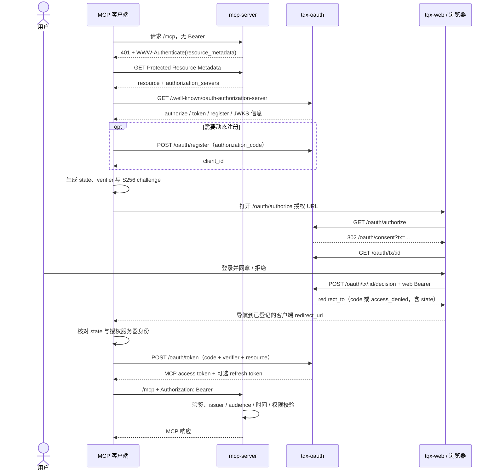

# MCP Server 接入 tqx-oauth Authorization Code Flow 计划

状态：MCP 资源发现和 Bearer 门禁已实现，浏览器端到端联调待完成。基线核对日期：2026-11-02。

本轮已完成 `src/config.ts`、`src/auth/` 与 `src/app.ts` 的配置、资源元数据、JWKS 验签和请求身份传递；`ping` 已改为认证后访问，健康检查保持匿名。已添加真实测试密钥验签、并发隔离、scope challenge、密钥轮换和故障测试，并更新 README、开发启动提示和 MCP 包内 `.env.example`。未修改 tqx-oauth、tqx-web 或部署配置，未接入 Device Flow。

当前仅验证资源服务器部分；测试中的签名 token 和 discovery 来自受控测试 fixture。真实客户端注册、浏览器登录/同意、回调、授权码兑换和刷新仍需在可达的联调环境验收，不能视为已完成。

## 1. 目标与范围

让远程 MCP 客户端通过 tqx-oauth 的 **Authorization Code Flow + PKCE S256** 完成用户登录授权，取得面向 MCP resource 的 access token，再访问受保护的 `/mcp`。

本轮包括认证发现、客户端识别/注册、浏览器登录与同意、授权码兑换、Bearer token 校验，以及授权码登录后的可选刷新。**不接入 Device Flow**：不调用 `/oauth/device/*`，不生成或展示 `user_code`、`device_code`、verification URI，不轮询设备授权状态，不在授权码失败时回退到设备登录。tqx-oauth 可以继续为其他产品提供 Device Flow；无需删除或伪造它的 discovery 能力。

本轮不实现业务工具、RFC 8693 Token Exchange、下游 Research/Trading Bearer 认证或交易执行。它们属于后续独立任务；登录成功不代表业务网关接入完成。MCP token 不得直接透传给下游 API。

“只接入 Authorization Code Flow”限定本次客户端登录路径。当前 access token claims 没有登录 grant 来源，MCP 不能仅凭 JWT 判断它是否源自 Device Flow；如未来要求拒绝所有设备授权签发的 token，需要 tqx-oauth 增加可验证的签发策略或来源契约，不能通过猜测 `client_id` 实现。

## 2. 已核对的现状

| 部分          | 当前行为                                                                  | 接入缺口                                                                    |
| ------------- | ------------------------------------------------------------------------- | --------------------------------------------------------------------------- |
| MCP HTTP 服务 | Hono + MCP SDK v2；`GET /healthz`，`app.all('/mcp')`；每次请求创建 server | 已发布 Protected Resource Metadata，已验证 Bearer token；真实 AS 联调待完成 |
| MCP 工具      | 只有认证后可用的 `ping`；测试覆盖 `2025-11-25` 与 `2026-07-28`            | 现有协议测试已接入真实 JWT 验签；业务工具尚未接入                           |
| tqx-oauth     | 已有 authorize、DCR、token、授权事务查询/决定、AS metadata 和 JWKS        | 需验证目标客户端互通性及部署契约，不能把本地接口存在当成生产已可用          |
| 授权码安全    | 已校验 redirect URI、PKCE S256、resource、scope；授权码一次性消费         | 客户端还需生成和核对 `state`，保管 verifier，并校验所选 issuer              |
| tqx-web       | tqx-oauth 会跳转到 `/oauth/consent?tx=...`；当前检查未发现对应同意页实现  | 浏览器登录、同意/拒绝和返回客户端是端到端联调前置依赖                       |
| SDK           | 当前认证请求使用 `X-API-Key`                                              | 本轮无需改 SDK；未来下游换票接入必须单独扩展 Bearer 支持                    |

已安装 `@modelcontextprotocol/server` 为 `2.4.0`，`@modelcontextprotocol/hono` 为 `2.0.2`。当前类型声明提供 `requireBearerAuth`、`oauthMetadataResponse`、`getOAuthProtectedResourceMetadataUrl` 和 `handler.fetch(..., { authInfo })`，可用于 Hono 的 Fetch 接口；实施时再次核对实际安装版本与[官方 SDK 授权文档](https://ts.sdk.modelcontextprotocol.io/v2/serving/authorization.html)。不引入 SDK v1、Express 认证路由或第二套 OAuth 授权服务器。

## 3. 角色与接口归属

| 角色                                    | 职责                                                                                                        |
| --------------------------------------- | ----------------------------------------------------------------------------------------------------------- |
| MCP 客户端（IDE、桌面端、Inspector 等） | 发现 AS、持有自己的 client ID、生成 state/PKCE、打开浏览器、接收回调、兑换及刷新 token、每次请求携带 Bearer |
| mcp-server（Resource Server）           | 发布资源元数据、发出认证 challenge、验证 token、隔离每次请求的身份与权限                                    |
| tqx-oauth（Authorization Server）       | 解析/注册客户端、维护授权事务、验证用户身份、签发/刷新 token、发布 metadata/JWKS                            |
| tqx-web                                 | 登录及同意页面，向 OAuth 服务查询事务和提交用户决定，再导航到服务返回的回调地址                             |

截图中的五个 OAuth 接口均属于 tqx-oauth，并非全部由 mcp-server 主动调用：

| HTTP 接口                     | 调用方与用途                                                                                                   |
| ----------------------------- | -------------------------------------------------------------------------------------------------------------- |
| `GET /oauth/authorize`        | MCP 客户端经浏览器发起授权；成功返回 302 到 tqx-web 同意页                                                     |
| `POST /oauth/register`        | 需要 DCR 的 MCP 客户端注册自身；JSON body，成功返回 201                                                        |
| `POST /oauth/token`           | MCP 客户端以表单兑换授权码或刷新 token；本轮不发送 device grant 或 token-exchange grant                        |
| `GET /oauth/tx/:id`           | tqx-web 加载待处理授权事务，展示客户端、资源、scope 和有效期                                                   |
| `POST /oauth/tx/:id/decision` | tqx-web 携带有效 web 登录 Bearer token，提交 `{ approved, agent_id? }`；返回 `{ redirect_to }`，由网页执行导航 |

MCP server 不提供 OAuth callback，不保存 code、verifier、refresh token 或 web 登录凭证，不代理上述注册/同意接口。外部客户端的 client ID 与后续换票使用的机密客户端（由 `TQX_MCP_EXCHANGE_CLIENT_ID` 配置）是不同身份，不能混用。

## 4. 完整登录时序



拒绝、超时、state 不匹配或换码失败均结束本次尝试；需要重试时重新开始授权码流程。任何环节都不转入设备登录。

## 5. 认证发现与公共配置

按 [RFC 9728](https://www.rfc-editor.org/rfc/rfc9728) 发布资源元数据。以下地址是目标部署示例，实际值必须与 tqx-oauth 配置及反向代理路由一同验证：

```json
{
  "resource": "https://www.tqx.trade/mcp",
  "authorization_servers": ["https://auth.tqx.ai"],
  "bearer_methods_supported": ["header"],
  "scopes_supported": [
    "research:read",
    "research:write",
    "research:run",
    "trade:read",
    "order:write",
    "ranking:read"
  ]
}
```

- 主地址为 `GET /.well-known/oauth-protected-resource/mcp`；如需根路径兼容，额外提供 `GET /.well-known/oauth-protected-resource`，内容描述同一资源。
- 未携带凭证时返回 `401`，示例 header：`WWW-Authenticate: Bearer resource_metadata="https://www.tqx.trade/.well-known/oauth-protected-resource/mcp"`。
- AS metadata 和 JWKS 分别由授权服务器提供：`/.well-known/oauth-authorization-server`、`/.well-known/jwks.json`。客户端直接访问 AS，不从 MCP 上伪造 AS metadata。
- 按当前需求，资源元数据公布全部六项 scope，与 TQX API Key 的研究权限组（`research:read`、`research:write`、`research:run`）和交易权限组（`trade:read`、`order:write`、`ranking:read`）以及 tqx-oauth 定义保持一致。元数据与 JWT scope 校验共用 `src/auth/scopes.ts`；公布权限不代表已实现对应业务工具。
- 客户端使用资源元数据作为初始 scope 集合时会申请全部六项，也可以显式申请子集。已有事务与 token 不自动扩权，需要重新发起授权。
- `resource`、AS issuer、JWKS 地址由受信任部署配置决定，不从请求的 Host、转发头、JWT `iss` 或 `jku` 动态拼出可信地址。

已实现以下 MCP 包运行时配置（四项均需显式配置；白名单以逗号分隔）：

| 配置                                                | 用途                                                                 |
| --------------------------------------------------- | -------------------------------------------------------------------- |
| `TQX_MCP_RESOURCE_URL`                              | 公网 canonical resource，须与 token `aud` 和 AS 的 MCP resource 一致 |
| `TQX_MCP_OAUTH_ISSUER`                              | 唯一可信 AS issuer；JWKS 地址从可信 AS metadata 校验取得             |
| `TQX_MCP_ALLOWED_HOSTS` / `TQX_MCP_ALLOWED_ORIGINS` | Hono Host / Origin 白名单；无 Origin 的原生客户端可正常接入          |

`ALLOWED_HOSTS` 使用无 scheme/port 的 hostname；`ALLOWED_ORIGINS` 使用精确的 scheme + host + port，可显式设为空，仅允许不带 Origin 的原生客户端。生产 URL/origin 必须 HTTPS；非生产允许 HTTP，包括局域网地址和主机名，Host/Origin 白名单与 token 校验仍生效。具体示例由 `packages/mcp-server/.env.example` 独立维护，本地配置放在同目录 `.env`，不修改工作区根 `.env.example`。在 `packages/mcp-server/` 中执行 `bun run dev`；`scripts/dev.mts` 按脚本位置显式加载包内 `.env`，再由子进程继承环境变量，已设置的进程环境变量优先。未提供 `.env` 时可使用已导出的变量，缺少必要配置仍拒绝启动。部署也可直接注入进程环境变量。配置 URL 规范化后与 AS/JWT 严格比较，不能使用含凭证、query 或 fragment 的配置。

生产只接受 HTTPS 公共地址，配置缺失/非法时启动失败，不静默退回匿名模式。Authorization Code 登录使用公共 MCP client，不需要 client secret；可选 Trading Token Exchange 由 `TQX_MCP_EXCHANGE_CLIENT_ID` 指定的 confidential client 负责，使用 `TQX_MCP_EXCHANGE_CLIENT_SECRET`，不改变已有 `TQX_BASE_URL` 语义。

Docker 部署配置位于 `docker/compose.yaml` 和 `docker/Dockerfile`：Compose 项目名为 `tqx-ts`，仅包含 `mcp-server` 服务，读取 MCP 包内 `.env`，发布 `61102` 端口，不启动 Inspector。基镜像使用 `docker.cnb.cool/liangyunzhijing/docker-sync/oven-bun:1.4.4-slim_amd64`，目标平台为 `linux/amd64`。可选 `TQX_MCP_BIND_HOST` 控制 Bun 入口监听地址，本地默认 `127.0.0.1`，容器固定为 `0.0.0.0`。镜像默认 `NODE_ENV=production`，本地 HTTP 联调须显式设置 `NODE_ENV=development`；容器中的 localhost 不是宿主机，issuer 的网络可达性和 JWT 标识须同时满足。构建上下文由 `Dockerfile.dockerignore` 限制，不包含 `.env` 或凭据。

本地监听 `http://127.0.0.1:61102/mcp` 与公网 resource 是不同概念。端到端测试必须使用 AS 明确支持的测试 resource，或由受控 HTTPS 测试入口转发到本地；不能把任意 localhost URI 当作 AS 已支持的 resource。客户端的 localhost callback 则按 AS redirect URI 规则单独登记。

## 6. 客户端授权码契约

### 6.1 客户端身份

优先验证目标客户端的 CIMD 支持：HTTPS client ID 指向该客户端自己的 metadata document，tqx-oauth 已有解析能力。当前 AS discovery 尚未声明 `client_id_metadata_document_supported`，需在联调阶段核对并由 OAuth 服务准确发布能力。DCR 保留为现有客户端的兼容入口；预登记 client ID 也可使用，但必须有真实注册记录，不能把任意常量当作已注册客户端。发现策略参见 [MCP Authorization Server Discovery](https://modelcontextprotocol.io/specification/2026-07-28/basic/authorization/authorization-server-discovery)。

公共桌面客户端使用 `token_endpoint_auth_method=none`。DCR 的最小 JSON body：

```json
{
  "client_name": "TQX MCP Test Client",
  "redirect_uris": ["http://127.0.0.1:8765/callback"],
  "token_endpoint_auth_method": "none",
  "grant_types": ["authorization_code", "refresh_token"]
}
```

只测试首次登录时可省略 `refresh_token` grant。始终显式限制 grant 列表，不加入设备授权或换票 grant；公共客户端不能内置共享 secret。

### 6.2 开始授权与回调

`GET /oauth/authorize` 携带以下 query，使用 URL API 编码：

| 参数                    | 要求                                                                                          |
| ----------------------- | --------------------------------------------------------------------------------------------- |
| `response_type`         | 固定 `code`                                                                                   |
| `client_id`             | 当前 MCP 客户端的 CIMD URL 或已注册 ID                                                        |
| `redirect_uri`          | 客户端自己的已登记回调地址；换码时保持完全一致                                                |
| `code_challenge_method` | 固定 `S256`                                                                                   |
| `code_challenge`        | 按 [RFC 7636](https://www.rfc-editor.org/rfc/rfc7636) 计算 `BASE64URL(SHA256(code_verifier))` |
| `resource`              | canonical MCP resource；显式发送，不依赖服务端缺省                                            |
| `scope`                 | 可申请上述六项；按资源元数据默认选择时申请全部，也可显式申请所需子集                          |
| `state`                 | 每次授权独立的高熵随机值；客户端必须保存、匹配并一次性消费                                    |

客户端接收 callback 时同时处理 `code` 和 `error=access_denied`，校验 state、回调上下文与预期 issuer。当前 tqx-oauth 回调只追加 code/error 和 state，未追加 RFC 9207 `iss`；需要核对目标客户端的 issuer 校验机制，要求 `iss` 的客户端须先完成 AS 契约补齐，不能关闭校验绕过。

tqx-web 读取事务后展示真实客户端名称、resource、申请权限、到期状态。未登录先完成现有 web 登录，再恢复同一事务；提交决定使用 web token，不使用 MCP token。申请 `trade:read` 或 `order:write` 时，当前 tqx-oauth 要求同意请求携带 `agent_id`，因此全 scope 联调需要同意页支持 Agent 选择。Agent 归属校验与实际部署行为仍需跨服务联调确认；本轮未修改 tqx-web 或 tqx-oauth。

### 6.3 授权码兑换与刷新

MCP 客户端向 AS `POST /oauth/token`，使用 `application/x-www-form-urlencoded`：

```text
grant_type=authorization_code
client_id=<registered-client-id>
code=<callback-code>
redirect_uri=<exact-original-redirect-uri>
code_verifier=<original-verifier>
resource=https://www.tqx.trade/mcp
```

上述逐行示例表示表单字段，实际发送时逐项编码。响应包括 `access_token`、`token_type=Bearer`、`expires_in`、`scope` 和可选 `refresh_token`。客户端保管凭证，并在每个 MCP HTTP 请求中发送 `Authorization: Bearer <access_token>`；token 不进入 URL、工具参数或日志。

授权事务当前有效期 600 秒，授权码 120 秒；access token 当前 30 天，refresh token 90 天。这是已核对的 AS 策略，不是 MCP 本地可延长的期限。客户端以响应和 token 到期时间为准，不硬编码这些时长。

刷新是授权码登录后的凭证续期，不是另一个交互登录入口。由客户端直接发送 `grant_type=refresh_token`、`client_id`、`refresh_token` 和同一 `resource`，保存轮换后的 refresh token；失败则重新走授权码登录。当前 AS 刷新处理没有独立校验表单中的 resource/scope，续用 session 的资源和权限；需联调确认不会发生扩权或资源漂移。当前不支持 `offline_access` scope，不应为了申请刷新 token 添加它。

## 7. MCP Bearer 校验与请求隔离

在 MCP handler 前增加 Fetch 风格认证门禁。优先复用已安装 SDK 的 `requireBearerAuth`，注入自己的 `OAuthTokenVerifier`，设置 `expectedResource` 与 `resourceMetadataUrl`，把结果通过 `handler.fetch(request, { parsedBody, authInfo })` 传递给本次请求。SDK 门禁不代替 JWT 验签实现。

1. 从 Authorization header 提取 Bearer；不接受 query token、web token 或 API key 替代。
2. 用可信 AS 的 JWKS 验证 JWT，固定当前 AS 使用的 RS256，验证 `kid`、签名、issuer、audience、`exp`，并检查存在的 `nbf`。拒绝 `none`、算法混淆、伪造及不完整 claims。优先使用维护中的 JOSE 验证库与 Web Crypto，不手写 JWT 密码学。
3. 用 Valibot 验证 TQX claims 的类型和边界：`sub`、`client_id`、`sid`、`jti`、`scope`、`iat`、`exp`，以及可选 `agent_id`。规范化身份写入请求级 `AuthInfo`，`resource` 必须来自已验证的 audience，不能直接填配置值掩盖错误。
4. JWKS 缓存只保存公开密钥，限制容量、超时和刷新频率；未知 kid 允许受限重取，重取失败则拒绝未验证 token。支持轮换期间合法旧 key，具体窗口与 AS 发布策略联调。
5. `/mcp` 的实际 MCP 请求统一认证，包括现有 `ping`，兼容两种已测试协议版本。当前门禁只要求有效 MCP token，不要求 token 拥有全部六项 scope；客户端仍可申请子集。后续工具声明各自 scope 并在调用前校验。
6. `/healthz`、资源元数据和合法 CORS OPTIONS 保持匿名；OPTIONS 只处理预检，不能执行 MCP。保留 Host/Origin 防护，为浏览器允许必要的 Authorization / MCP headers 并暴露 `WWW-Authenticate`，错误响应也经过 CORS。
7. 只把身份放在本次调用上下文，不使用全局“当前用户”，不把 MCP session header 当成身份。多用户并发、长连接重连或进程重启均重新按请求凭证判定。

错误通过 HTTP 认证语义在工具执行前返回：无凭证为 `401` challenge；过期、错误 audience/issuer 或坏签名为 `401 invalid_token`；有效 token 缺少具体操作 scope 为 `403 insufficient_scope` 并带所需 scope。JWKS 上游不可用且没有可用可信密钥时按服务故障返回安全的 5xx，不伪装成用户拒绝授权，也不放行。[MCP 授权规范](https://modelcontextprotocol.io/specification/2026-07-28/basic/authorization)定义了 Bearer 与权限错误约定。

### 撤销边界

离线 JWT 验签不能得知 AS session/JTI 已撤销。当前已核对的 tqx-oauth HTTP 路由中没有标准 introspection 接口，因此本计划不虚构 `/oauth/introspect`，MCP 也不得直接连接其数据库读取状态。

第一阶段仅以 `ping` 验证登录与签名认证，明确记录“已撤销 token 可能在 exp 前通过离线门禁”的限制。**接入真实账户数据、写操作或生产业务工具前**，必须另行落实标准在线状态校验或已有 Token Exchange 的实时撤销检查，并定义只读缓存撤销窗口。当前 access token 有效期较长，不能把离线验签描述成即时登出；JWKS 刷新也不能替代用户会话撤销。

## 8. 实施顺序与交付物

当前进度：P1、P2 已完成；P0 的真实客户端/公网契约和 P3 的浏览器端到端仍待联调；P4 的代码文档与配置示例已同步，完整验收仍依赖联调结果。资源服务器仅拉取可信 AS metadata 和同源 JWKS；没有为客户端实现换码、刷新或设备授权调用。

| 阶段             | 工作与预计改动位置（相对 MCP 包）                                                                                            | 完成标准                                                                      |
| ---------------- | ---------------------------------------------------------------------------------------------------------------------------- | ----------------------------------------------------------------------------- |
| P0：契约与环境   | 确认公网 resource/issuer、AS metadata/JWKS、客户端 callback、CIMD/DCR 能力、同意页依赖                                       | 固定一个可测试客户端；记录 RFC 9207/CIMD discovery 差异；不要求 Device Flow   |
| P1：资源发现     | 新增 `src/config.ts`、`src/auth/metadata.ts`；接入 `src/app.ts`；补 `test/auth-metadata.test.ts`                             | 匿名访问 /mcp 得到可用 challenge，metadata resource 与 AS 配置一致            |
| P2：Bearer 门禁  | 新增 `src/auth/verifier.ts`、`src/auth/claims.ts`；必要时更新包依赖/锁文件；补 `test/auth.test.ts` 和调整 `test/app.test.ts` | 真实验签、过期与 audience 检查通过；合法 token 可调 ping；请求身份无串用      |
| P3：浏览器端到端 | 协调 tqx-web 同意页和 AS 兼容项；更新 `scripts/dev.mts` / `test/dev.test.ts` 中必要的开发配置与预期                          | Inspector 或指定客户端完成浏览器授权、回调、换码、认证后 ping、拒绝及重新登录 |
| P4：文档与验证   | 更新 `README.md`、MCP 包内 `.env.example` 及本计划状态                                                                       | 全量检查通过，清楚记录生产路由、撤销限制和后续业务接入条件                    |

新配置由 MCP 包读取，不把 AS 地址或认证流程塞进工具 handler。若后续需要 SDK 调用 OAuth/业务后台，仍需遵守工作区的 endpoint 集中管理与依赖方向；本轮 MCP resource server 没有此需求。

通用辅助函数统一放在 `src/utils/`，按用途分文件管理。当前 `parseList`、`parsePublicUrl` 和 `configurationError` 已移至 `src/utils/config.ts`，`src/config.ts` 保留环境变量 schema 和 MCP 配置组装，校验行为不变。

tqx-web、tqx-oauth、网关和部署变更均为后续跨仓库交付，本次未修改。现有架构文档里的统一下游 `/api` audience 也不能直接作为实施契约；后续 Token Exchange 应分别核对 Research `/pandaApi`、Trading `/openapi` 的真实 resource，本轮不扩展其实现。

## 9. 验收与检查

| 范围             | 必须验证                                                                                                                              |
| ---------------- | ------------------------------------------------------------------------------------------------------------------------------------- |
| 发现             | 带路径的 well-known 地址可用；challenge URL 不受恶意 Host 影响；issuer/resource 严格匹配；metadata 不宣告未接入权限                   |
| 授权码正向       | 公共客户端注册/解析；PKCE S256；登录后同意；state 校验；一次性 code 换 token；认证后调用 ping                                         |
| 授权码异常       | 用户拒绝、事务过期、code 过期/复用、错误 verifier、redirect URI/client ID/resource 不匹配、回调 state 错误；失败不转设备登录          |
| Token 门禁       | 无 token、坏格式、伪造签名、错误算法/issuer/audience、过期/未来 nbf、缺失或错误 claims；Research/Trading token 不可用于 MCP           |
| 权限与隔离       | 有效 token 缺 scope 的 403 challenge；用户 A/B、client A/B 并发不串身份；健康与元数据匿名；两种现有 MCP 协议回归                      |
| 密钥与网络       | 未知 kid、密钥轮换、JWKS 超时/错误 payload、刷新限流；fetch/时钟/验证器可注入；失败不绕过认证                                         |
| 刷新             | 客户端直接刷新并更新轮换凭证；资源/权限保持；旧 refresh replay 或会话撤销后的恢复行为与 AS 契约一致                                   |
| 浏览器与代理     | CORS 可读取 401/403 challenge；同意页实际存在；回调和 HTTPS 路由可达；Inspector 启动不依赖匿名 ping                                   |
| Device Flow 排除 | 自有测试客户端与本次端到端网络记录中不存在设备授权请求、device grant、user code 展示或设备轮询；AS 全局 metadata 的设备能力不构成失败 |
| 交付边界         | README 明确登录完成范围及离线撤销限制；不泄漏 code/verifier/token/secret；未接下游业务不写成业务工具已可用                            |

单元测试用测试密钥生成并验证 JWT，不仅 mock 出“认证成功”。浏览器端到端联调使用受控测试账号和资源；不能仅用手工 token 注入替代授权码全链路验收。

实施时在工作区根目录执行窄测试，再执行完整门禁：

```bash
bun run test:unit packages/mcp-server/test
bun fmt packages/mcp-server/docs/oauth-authorization-code-plan.md
bun run format:check
bun run test
git diff --check
```

其他修改过的 Markdown 也需逐一执行 `bun fmt` 并审阅差异。真实浏览器登录、测试部署可达性及跨仓库依赖必须单独记录结果，不能用 workspace 测试通过替代。本轮单元测试和 Bun 认证运行验证不代表授权码全链路或尚未接入的业务工具已完成。
